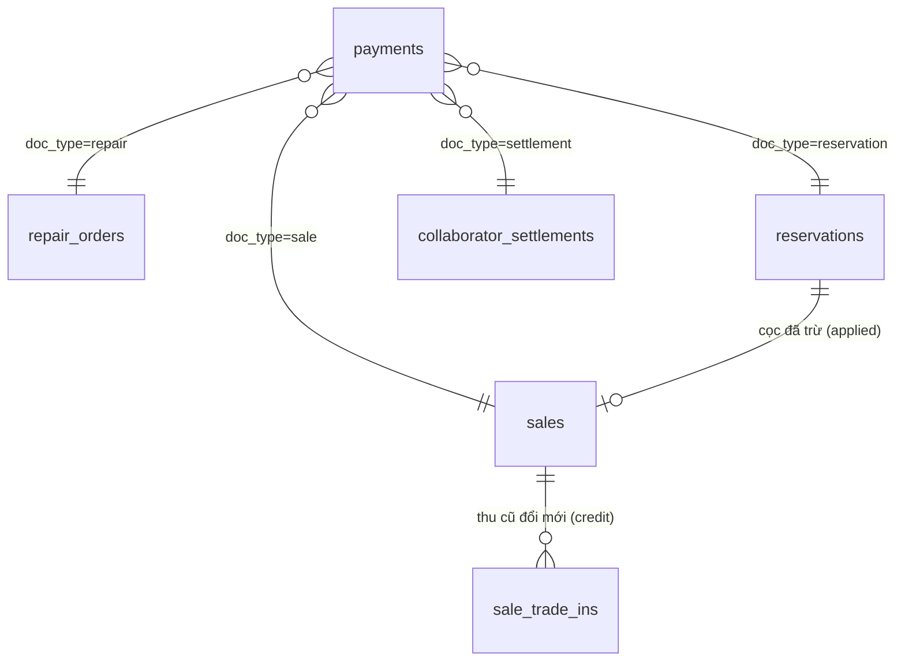

# Tiền & thanh toán (tối giản)

> Cập nhật lần cuối: 2026-10-16 · Trạng thái: Duyệt · Thay thế `money-and-ledger` (đã hoãn cùng module Thu chi & quỹ — CF-07). Quy tắc gốc: BR-PAY-*, BR-SALE-05/06, BR-RSV-*, BR-TRD-*, BR-COL-*.
> Bản đầy đủ có quỹ, sổ quỹ chuỗi băm, bù trừ, khóa kỳ: `docs/99-archive/2026-10-16-full-scope/02-domain/money-and-ledger.md`.

## 1. Nguyên lý (đọc kỹ — mọi thứ khác suy ra từ đây)

1. **Chứng từ nói "phải thu bao nhiêu"** (phiếu bán, phiếu sửa); **thanh toán nói "khách đã trả bao nhiêu"**. Mỗi thanh toán gắn **đúng một** chứng từ.
2. **Doanh thu tính từ chứng từ, không từ thanh toán** (BR-PAY-02). Nhờ vậy cọc, hoàn cọc, giá thu CTV nộp không thể lẫn vào doanh thu.
3. **Không có quỹ/sổ quỹ/số dư.** Ứng dụng chỉ biết "đã thu bao nhiêu, bằng cách nào, cho phiếu nào". Muốn biết tiền trong két phải đếm tay (ngoài hệ thống).
4. **Thanh toán bất biến.** Sai ⇒ hủy (có lý do) rồi ghi lại. Không có sửa số tiền.
5. **Không cache** số "đã trả/còn nợ" trong chứng từ — luôn tính từ dữ liệu bằng view `v_doc_balances`, để không thể lệch.
6. Thu cũ đổi mới và cọc áp vào phiếu bán là **thành phần trừ** của phiếu (bản ghi riêng), không phải thanh toán, nên không có bù trừ "kép".

## 2. Mô hình dữ liệu tiền



`payments`: `code` (PT-…), `direction` (`in`/`out`), `purpose`, `method` (`cash`/`bank_transfer`), `amount_vnd > 0`, `doc_date`, `doc_type` + `doc_id` (đúng một), `customer_id` (nếu có), `note`, `status` (`posted`/`voided`), `voided_at/by`, `void_reason`, `created_by`.

### 2.1 Danh mục `purpose`

| Hướng | purpose | Gắn vào (`doc_type`) | Là doanh thu? | Tính vào "thực thu"? |
|---|---|---|---|---|
| in | `sale_receipt` | `sale` | Không (doanh thu tính từ phiếu) | Thực thu |
| in | `repair_receipt` | `repair` (kể cả cọc sửa) | Không | Thực thu |
| in | `deposit_receipt` | `reservation` | Không | Thực thu (hiển thị riêng "cọc") |
| in | `collab_settlement` | `settlement` | Không (doanh thu cửa hàng của đơn CTV tính từ phiếu bán) | Thực thu |
| out | `deposit_refund` | `reservation` | — | Trừ khỏi thực thu |
| out | `repair_deposit_refund` | `repair` | — | Trừ khỏi thực thu |

Ràng buộc: `purpose` quyết định `doc_type` (CHECK). Không có khoản vay/thu hộ/chi phí — ngoài phạm vi (CF-07).

## 3. Công thức còn nợ (view `v_doc_balances`)

Với mỗi chứng từ, chỉ tính thanh toán `posted`:

- **Phiếu bán (cửa hàng bán)**
  - `payable = grand_total − Σ sale_trade_ins.credit − reservation.applied` (cọc đã trừ vào phiếu này).
  - `paid_net = Σ in(sale_receipt)` của phiếu.
  - `due = payable − paid_net` (≥ 0; vượt ⇒ `WF-PAY-OVERPAY`). `due > 0` = **khách còn nợ**.
- **Phiếu bán của CTV**: khách trả cho CTV, **không có thanh toán của khách trong hệ thống**. Nghĩa vụ của CTV: `shop_due_line = base_price_snapshot` cho tới khi quyết toán (§6).
- **Phiếu sửa**: trước `delivered`, `paid_net` = tiền nhận trước (cọc); sau `delivered`, `due = tổng phải thu − paid_net` (`paid_net = Σ in(repair_receipt) − Σ out(repair_deposit_refund)`). Phiếu `warranty_free`: phải thu = 0.
- **Giữ hàng**: `cọc đang giữ = Σ in(deposit_receipt) − Σ out(deposit_refund) − applied_vnd − forfeited_vnd`; khi đóng giữ hàng, `cọc đã thu = applied + refunded + forfeited` (BR-RSV-05).

Tổng hợp:
- **Khách còn nợ** = Σ `due` (phần dương) của phiếu bán `confirmed` (cửa hàng bán) + phiếu sửa `delivered` — hiển thị ở danh sách phiếu (bộ lọc "còn nợ") và hồ sơ khách. Không có màn "Công nợ" riêng (CF-06).
- **CTV chưa nộp** = Σ `base_price_snapshot` các dòng CTV bán đã `confirmed` chưa quyết toán.
- **Cọc/tiền nhận trước đang giữ** của khách = Σ cọc giữ hàng còn lại + Σ `paid_net` phiếu sửa chưa giao.

## 4. Các dòng chảy chuẩn (ví dụ có số)

### 4.1 Bán thường, thanh toán kết hợp (SC-02)
Phiếu bán `grand_total = 8.200.000`. Khách trả 5.000.000 tiền mặt + 3.200.000 chuyển khoản.
- Hai `payments(in, sale_receipt)` gắn phiếu: 5.000.000 (`cash`), 3.200.000 (`bank_transfer`). `paid_net = 8.200.000`, `due = 0`.

### 4.2 Bán có tiền thừa (SC-03)
Phiếu `6.500.000`, khách đưa 7.000.000 tiền mặt. `payments(in)` = **6.500.000** (không phải 7.000.000). `cash_tendered=7.000.000` chỉ lưu để in "tiền thừa 500.000".

### 4.3 Bán nợ & thu thêm (SC-04)
Phiếu `1.800.000`, khách trả 500.000 tiền mặt ⇒ `due = 1.300.000`, `due_date` đặt. Sau đó khách trả 1.000.000 chuyển khoản qua nút **Thu thêm** ngay trên phiếu: một `payment(in, sale_receipt)` ⇒ `due = 300.000`. Trả vượt 1.300.000 ⇒ `WF-PAY-OVERPAY`.

### 4.4 Cọc → bán (SC-05)
1. Giữ hàng chiếc D, cọc 2.000.000 tiền mặt: `payment(in, deposit_receipt)` gắn giữ hàng. **Cọc đang giữ = 2.000.000. Doanh thu = 0.**
2. Bán, `grand_total = 13.500.000`; chuyển thành bán: `reservations.applied_vnd = 2.000.000` (cọc còn 0); `payable = 13.500.000 − 2.000.000 = 11.500.000`. Khách trả thêm 11.500.000 chuyển khoản ⇒ `due = 0`. **Thực thu tổng = 2.000.000 + 11.500.000.**

### 4.5 Hủy giữ (SC-05, nhánh phụ)
- **Hoàn cọc**: `payment(out, deposit_refund)` 2.000.000 ⇒ cọc 0; thực thu ròng 0.
- **Tịch thu**: `reservations.forfeited_vnd = 2.000.000` (cần `reservation.forfeit`); cọc 0; ghi vào **"thu nhập khác"** ở báo cáo tiền thu; không thanh toán mới (tiền đã thu từ lúc cọc).

### 4.6 Thu cũ đổi mới (SC-06)
Phiếu bán `20.000.000`; máy cũ thu giá 6.000.000; khách chuyển khoản 14.000.000.
- Phiếu nhập `trade_in` 6.000.000 (xác nhận cùng transaction); `sale_trade_ins.credit = 6.000.000`.
- `payable = 20.000.000 − 6.000.000 = 14.000.000`; `payment(in, sale_receipt, bank_transfer)` 14.000.000 ⇒ `due = 0`. **Thực thu chỉ 14.000.000**, doanh thu 20.000.000.

### 4.7 Sửa chữa có cọc (SC-08)
Cọc 200.000 tiền mặt lúc nhận: `payment(in, repair_receipt)` gắn phiếu sửa. Giao máy, tổng 900.000: khách trả thêm 700.000 chuyển khoản. Doanh thu sửa chữa 900.000 ghi nhận lúc `delivered`; `due = 0`.

## 5. Hủy thanh toán
`fn_void_payment(payment_id, reason)` (cần `payment.void`): đặt `status='voided'` — chứng từ tự tính lại `due`. Không xóa. Nếu chứng từ gốc là phiếu bán đã `voided` thì các thanh toán của nó đã bị hủy cùng (BR-SALE-10). Hủy thanh toán của phiếu đang có cọc giữ hàng chưa đóng không ảnh hưởng giữ hàng (cọc là thanh toán riêng của giữ hàng).

## 6. Cộng tác viên: tiền chảy thế nào (CF-03)

```text
Chủ giao chiếc cho CTV, báo giá thu G (ví dụ 7.000.000)
CTV bán cho khách giá P (ví dụ 8.200.000), tự thu tiền của khách
Cửa hàng xác nhận đơn CTV  → doanh thu cửa hàng = G ; giá vốn = V (6.060.000) ; lãi gộp = G − V
CTV nộp G cho chủ          → Quyết toán: payment(in, collab_settlement) = G  (thực thu)
CTV hưởng                   = P − G (ví dụ 1.200.000; âm nếu P < G)
```

- Khoản **P − G không bao giờ vào doanh thu của cửa hàng** (BR-COL-04); chỉ xuất hiện ở *Thống kê CTV*.
- `quyết toán` gộp nhiều dòng của một CTV; mỗi dòng chỉ quyết toán một lần (BR-COL-06). Hủy quyết toán (owner + lý do) ⇒ dòng trở lại "chưa nộp".
- Cửa hàng **không** biết khách trả CTV bao nhiêu thật sự — chỉ biết giá bán CTV khai trên đơn (BR-COL-05). Đây là điểm cần tin cậy giữa chủ và CTV; chủ có thể đối chiếu ngoài hệ thống.

## 7. Báo cáo tiền thu (thay cho "Thu chi & số dư")

`rpt_collections(từ, đến)`: Σ thanh toán `posted` theo `doc_date`, tách theo `method` và `purpose`; hiển thị riêng: *cọc* (nhận/hoàn/tịch thu), *CTV nộp (quyết toán)*; cuối bảng **Thực thu = in − out**. Không có số dư đầu/cuối vì không có quỹ.

## 8. Những gì **không còn** (đã hoãn — xem archive)
Quỹ tiền mặt/ngân hàng · sổ quỹ chuỗi băm · bù trừ (offset) · phiếu chi (chi phí, trả NCC, hoa hồng, tiền công) · chuyển quỹ · điều chỉnh quỹ · đối chiếu · khóa kỳ · khoản vay/thu hộ · phân bổ thanh toán nhiều phiếu · đổi trả/hoàn tiền. Khi khách cần lại, bật module `finance` theo `extensibility` §7 — các `payments` hiện có sẽ nhập được vào quỹ bằng migration (mỗi `payment` thật ⇒ một bút toán).
