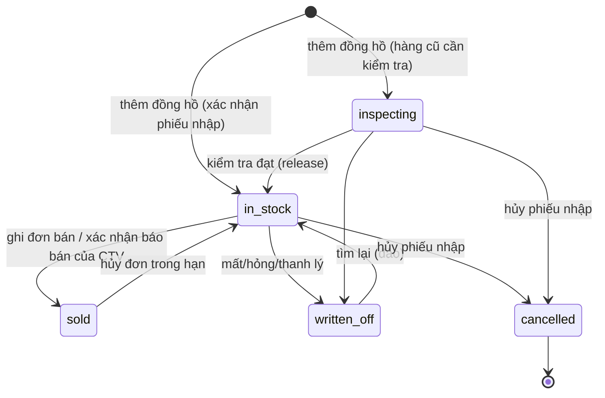
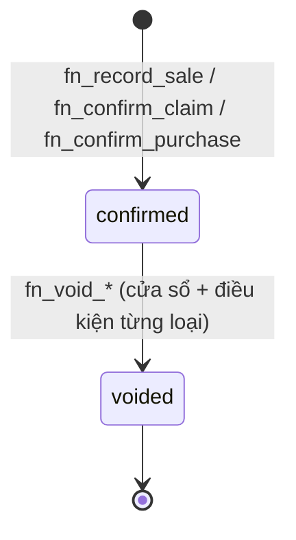
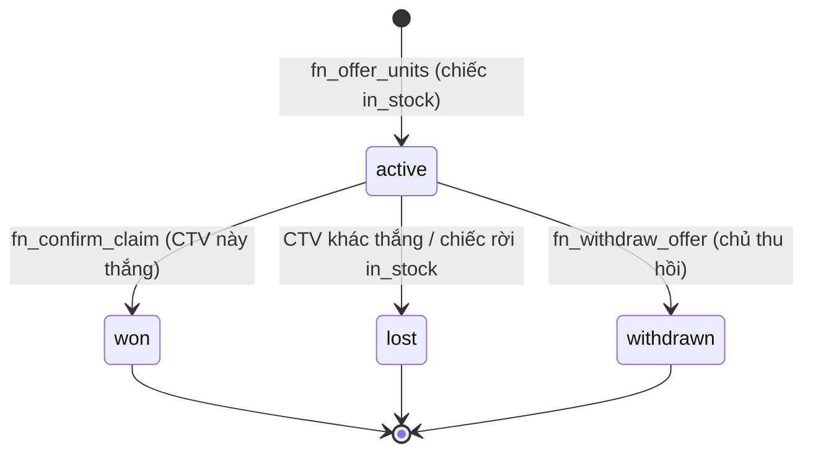
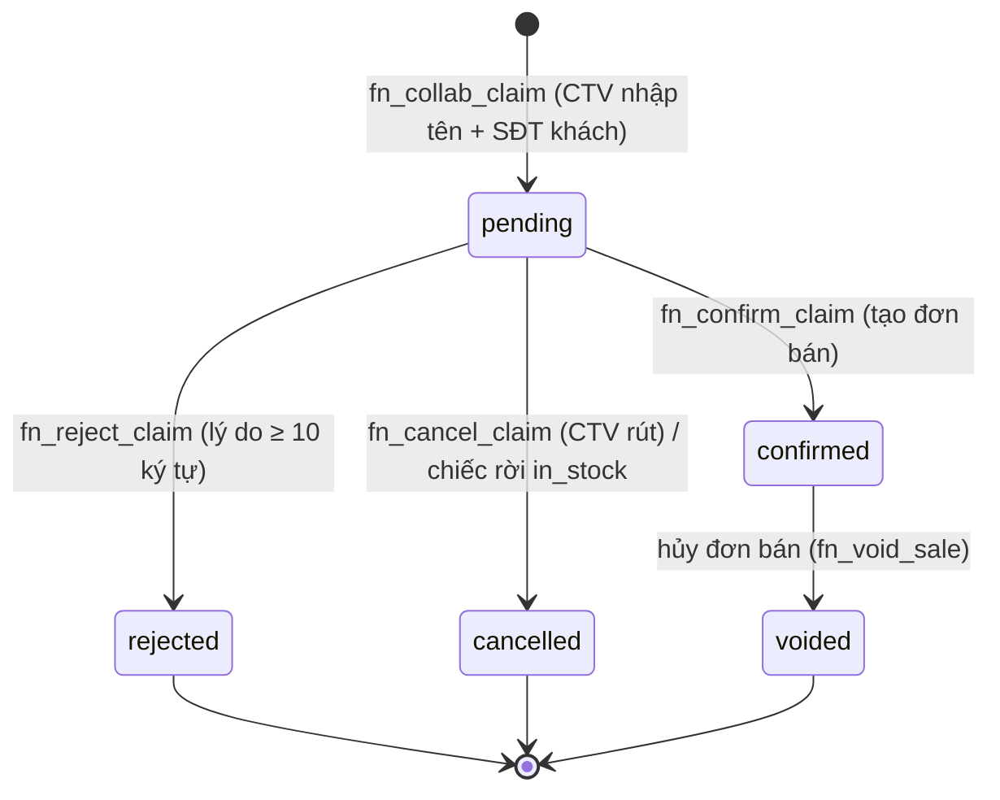
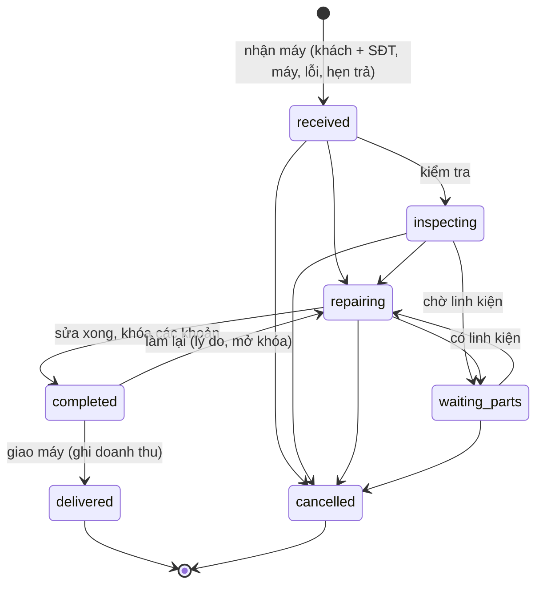

# Trạng thái & chuyển trạng thái

> Cập nhật lần cuối: 2026-10-18 · Trạng thái: Duyệt (đã cập nhật theo `customer-feedback-02`)
> Mọi chuyển trạng thái **chỉ** xảy ra qua hàm `app.fn_*` nêu ở cột "Hàm". Cột `status` không có quyền `UPDATE` cho `wf_app`; trigger kiểm ma trận ở đây (`app.unit_transition_allowed`) làm lớp phòng thủ thứ hai. Mỗi chuyển ghi `*_status_history` (append-only).
> **Đóng băng từ `customer-feedback-02`:** trạng thái `reserved`, `with_collaborator`, `in_repair` (sửa nội bộ) và các đường đi liên quan còn trong ma trận DB để dữ liệu cũ đọc được, nhưng **không còn hàm/giao diện nào đưa chiếc vào các trạng thái này**. Mục §1 chỉ vẽ đường đang dùng; đường đóng băng ghi ở cuối mục.

## 1. Đồng hồ (`watch_units.status`)

| Từ → Đến | Hàm | Quyền | Điều kiện / ghi chú |
|---|---|---|---|
| ∅ → `in_stock` / `inspecting` | `fn_confirm_purchase` (qua "Thêm đồng hồ" hoặc Nhập Excel) | `purchase.confirm` | Theo `initial_status` của dòng; hàng cũ phải đủ BR-UNIT-10 |
| `in_stock` → `sold` | `fn_record_sale` | `sale.confirm` | Khóa chiếc `FOR UPDATE`; chiếc phải `in_stock` và không có báo bán CTV đang chờ (BR-SALE-20) |
| `in_stock` → `sold` | `fn_confirm_claim` | `sale.confirm` | Xác nhận báo bán của CTV; tạo đơn trong cùng transaction (BR-COL-14) |
| `sold` → `in_stock` | `fn_void_sale` | `sale.void` | Trong cửa sổ hủy, lý do + nhập lại mật khẩu (BR-SALE-22) |
| `inspecting` → `in_stock` | `fn_release_unit` | `unit.release` | Ghi lý do/biên bản kiểm tra |
| → `written_off` | `fn_writeoff_unit` | `stock.writeoff` | Lý do bắt buộc; **tự đóng chào hàng/báo bán CTV của chiếc** (BR-COL-16) |
| `written_off` → `in_stock` | `fn_restore_unit` | `stock.writeoff` | Tìm lại; lý do bắt buộc |
| `in_stock`/`inspecting` → `cancelled` | `fn_void_purchase` | `purchase.void` | BR-PUR-07; trạng thái cuối |

**Chiếc đang giao cho CTV vẫn là `in_stock`** — "đang giao" là quan hệ `collaborator_offers`, không phải trạng thái (xem §3). Cửa hàng vẫn bán trực tiếp được.

**Không có đường**: `sold → written_off` (không đổi trả — dùng bảo hành), `cancelled → *`.

**Đóng băng (đường cũ, không còn được gọi):** `in_stock ⇄ reserved` (giữ hàng), `in_stock ⇄ with_collaborator` (giao CTV kèm giá thu), `sold → with_collaborator` (hủy đơn CTV cũ), `in_stock/inspecting ⇄ in_repair` (sửa nội bộ), `sold → in_stock/inspecting` (mua lại đúng chiếc, `cost_cycle + 1`). Đơn cũ vẫn hủy được bằng `fn_void_sale_v1`.

Ánh xạ nhãn tiếng Việt: Sẵn sàng bán · Chờ kiểm tra · Đã bán · Thanh lý/mất · Nhập nhầm (· Đã giữ / Đang ở CTV / Đang sửa — chỉ còn với dữ liệu cũ).

## 2. Chứng từ

- Đơn bán **không có nháp**: ghi là có hiệu lực ngay (`confirmed`). Phiếu nhập qua "Thêm đồng hồ"/Nhập Excel cũng lập rồi xác nhận trong cùng transaction.
- `confirmed`: bất biến. Mọi sửa sai đi qua `voided` rồi ghi lại.
- `voided`: giữ lại để tra cứu, loại khỏi mọi báo cáo doanh thu/số lượng.
- Điều kiện hủy: phiếu nhập → BR-PUR-07; đơn bán → BR-SALE-22.
- Trạng thái `draft` còn trong DB cho chứng từ cũ (phiếu bán nháp, phiếu giao CTV cũ…) nhưng không còn đường tạo.

## 3. Chào hàng & báo bán của CTV

**Chào hàng** (`collaborator_offers.status`): mỗi cặp (chiếc, CTV).

**Báo bán** (`collaborator_claims.status`): chỉ **một** báo bán `pending` cho mỗi chiếc (unique index + khóa chiếc — "ai báo trước được giữ").

| Chuyển | Hàm | Quyền | Hiệu ứng chính |
|---|---|---|---|
| → chào hàng `active` | `fn_offer_units` | `collab.manage` | Chiếc phải `in_stock`; giao lại không nhân đôi (BR-COL-12) |
| `active` → `withdrawn` | `fn_withdraw_offer` | `collab.manage` | Không thu hồi khi có báo bán chờ (`WF-COL-CLAIM-PENDING`) |
| → báo bán `pending` | `fn_collab_claim` | `collab.view_own` | Chỉ CTV có chào hàng `active`; người sau `WF-COL-CLAIMED` (BR-COL-13) |
| `pending` → `confirmed` | `fn_confirm_claim` | `sale.confirm` | Chiếc `sold`; chào hàng thắng `won`, còn lại `lost` + thông báo (BR-COL-14) |
| `pending` → `rejected` | `fn_reject_claim` | `sale.confirm` | Chào hàng còn nguyên, chiếc mở lại (BR-COL-15) |
| `pending` → `cancelled` | `fn_cancel_claim` | `collab.view_own` | Chỉ chính CTV đó |
| chào hàng `active` → `lost`, báo bán `pending` → `cancelled` | trigger khi chiếc rời `in_stock` | — | BR-COL-16; bất biến I13–I15 kiểm hằng đêm |

## 4. Phiếu sửa chữa (`repair_orders.status`)

Chỉ chủ thao tác (BR-REP-16, BR-REP-17); trạng thái chủ yếu để **ghi nhận tiến độ**; cho phép nhảy bước tiến.

| Chuyển | Hàm | Quyền | Hiệu ứng chính |
|---|---|---|---|
| tạo → `received` | `fn_create_repair` | `repair.create` | Chỉ phiếu khách (`kind='customer'`); `warranty_free` nếu chọn bảo hành còn hạn |
| → `inspecting` / `repairing` / `waiting_parts` | `fn_set_repair_status` | `repair.update` | Không còn duyệt báo giá |
| → `completed` | `fn_complete_repair` | `repair.update` | Khóa các khoản, chốt tổng |
| `completed` → `repairing` | `fn_set_repair_status` | `repair.update` + lý do | Mở khóa |
| `completed` → `delivered` | `fn_deliver_repair` | `repair.deliver` | Doanh thu = tổng khoản (phiếu tính phí) hoặc 0 (bảo hành); bảo hành sau sửa; **không thu tiền/ghi nợ** |
| → `cancelled` | `fn_cancel_repair` | `repair.update` + lý do ≥ 10 ký tự | Chỉ trước khi sửa xong |

## 5. Các đối tượng khác

| Đối tượng | Trạng thái | Chuyển |
|---|---|---|
| `warranties.status` | `active → expired` (job hằng ngày) · `active → voided` (hủy đơn bán) | |
| `users.status` | `active ⇄ locked` (tự khóa tạm) · `active → disabled` | `server/auth`, `fn_set_user_status` |
| `payments`, `reservations`, `stocktakes`, `collaborator_assignments`, `collaborator_settlements` | **đóng băng** — dữ liệu cũ còn đọc được, không còn hàm nào được gọi | xem `99-archive/2026-10-16-full-scope/02-domain/state-machines.md` |

**Đã hoãn** (không còn trong phạm vi xây): `account_transfers`, `financial_periods`, `sale_commissions`, `returns` — xem `docs/99-archive/2026-10-16-full-scope/02-domain/state-machines.md`.
