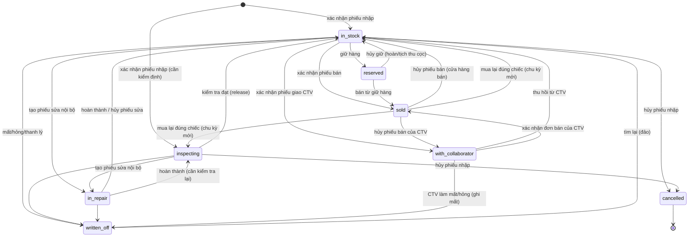
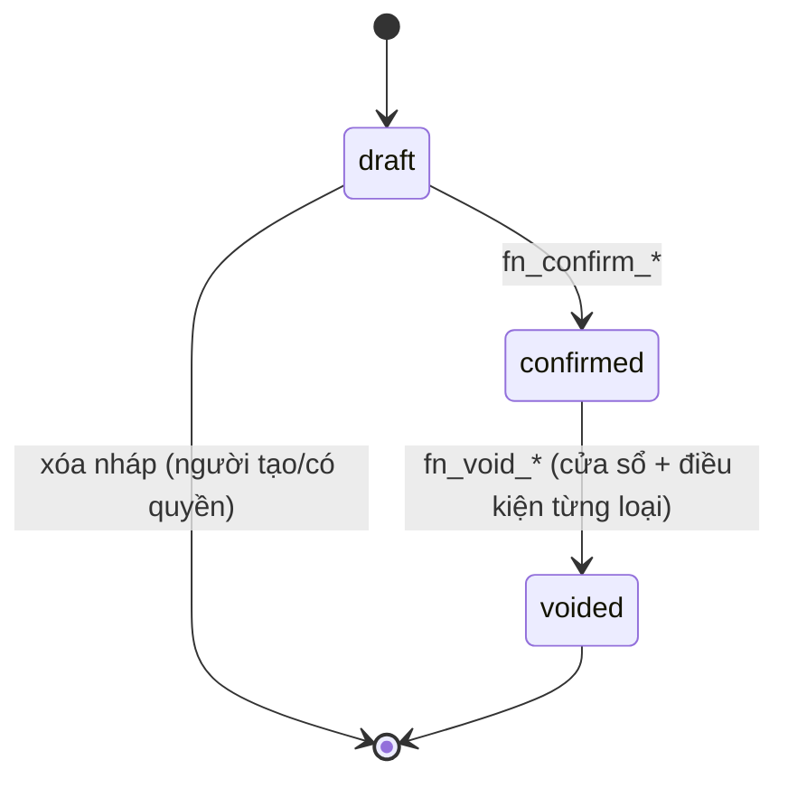
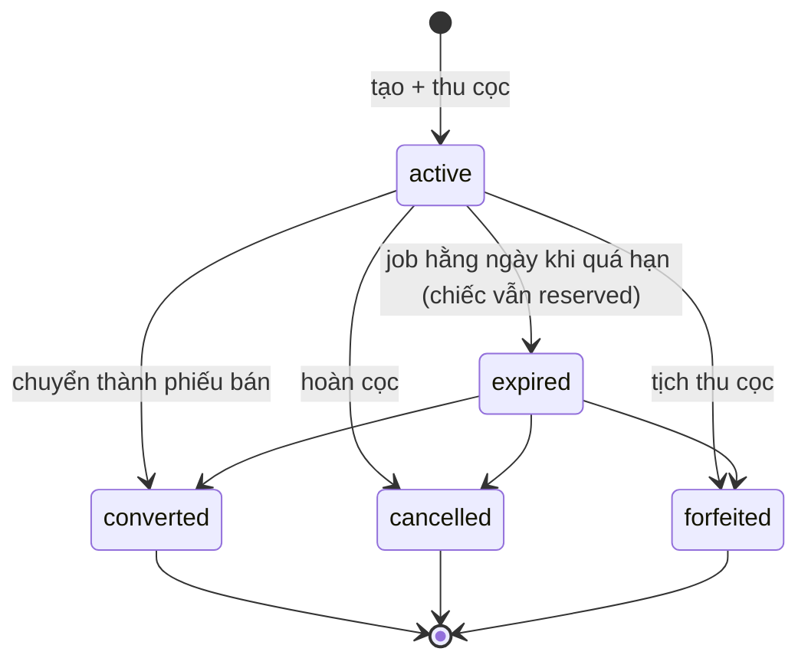

# Trạng thái & chuyển trạng thái

> Cập nhật lần cuối: 2026-10-16 · Trạng thái: Duyệt (đã cập nhật theo `customer-feedback-01`)
> Mọi chuyển trạng thái **chỉ** xảy ra qua hàm `app.fn_*` nêu ở cột "Hàm". Cột `status` không có quyền `UPDATE` cho `wf_app`; trigger kiểm ma trận ở đây (`app.unit_transition_allowed`) làm lớp phòng thủ thứ hai. Mỗi chuyển ghi `*_status_history` (append-only).

## 1. Đồng hồ (`watch_units.status`)

| Từ → Đến | Hàm | Quyền | Điều kiện / ghi chú |
|---|---|---|---|
| ∅ → `in_stock` / `inspecting` | `fn_confirm_purchase` | `purchase.confirm` | Theo `initial_status` của dòng; hàng cũ phải đủ BR-UNIT-10 |
| `sold` → `in_stock` / `inspecting` | `fn_confirm_purchase` | `purchase.confirm` | Mua lại đúng chiếc: `cost_cycle + 1` (BR-PUR-10) |
| `in_stock` → `reserved` | `fn_create_reservation` | `reservation.manage` | Có cọc ≥ mức tối thiểu; unique một giữ hàng hiệu lực/chiếc |
| `reserved` → `in_stock` | `fn_cancel_reservation` | `reservation.manage` (+ `reservation.forfeit` nếu tịch thu) | Hoàn cọc hoặc tịch thu |
| `in_stock` → `sold` | `fn_confirm_sale` | `sale.confirm` | Khóa chiếc `FOR UPDATE`; kiểm trạng thái |
| `reserved` → `sold` | `fn_confirm_sale` (từ giữ hàng) | `sale.confirm` | Chỉ giữ hàng của chính khách/phiếu |
| `in_stock` → `with_collaborator` | `fn_confirm_assignment` | `collab.manage` | Nhập giá thu; không giao chiếc `reserved`; BR-COL-01 |
| `with_collaborator` → `in_stock` | `fn_return_from_collaborator` | `collab.manage` | Vị trí kho + lý do; BR-COL-07 |
| `with_collaborator` → `sold` | `fn_confirm_sale` (đơn CTV) | `sale.confirm` | Chỉ chiếc được giao cho đúng CTV của đơn; BR-COL-03 |
| `sold` → `with_collaborator` | `fn_void_sale` (đơn CTV) | `sale.void` | Trong cửa sổ hủy, dòng chưa quyết toán; BR-COL-08 |
| `sold` → `in_stock` | `fn_void_sale` (cửa hàng bán) | `sale.void` | Trong cửa sổ hủy; BR-SALE-10 |
| `inspecting` → `in_stock` | `fn_release_unit` | `unit.release` | Ghi lý do/biên bản kiểm tra |
| `in_stock`/`inspecting` → `in_repair` | `fn_create_repair` (internal) | `repair.create` | BR-REP-11 |
| `in_repair` → `in_stock`/`inspecting` | `fn_complete_repair` / `fn_cancel_repair` | `repair.update` | Vốn hóa chi phí khi `completed` |
| → `written_off` | `fn_writeoff_unit`, `fn_reconcile_stocktake` | `stock.writeoff` | Lý do bắt buộc; hao hụt = giá vốn; từ `with_collaborator` chỉ chủ |
| `written_off` → `in_stock` | `fn_restore_unit` | `stock.writeoff` | Tìm lại; lý do bắt buộc |
| `in_stock`/`inspecting` → `cancelled` | `fn_void_purchase` | `purchase.void` | BR-PUR-07; trạng thái cuối |

**Không có đường**: `reserved → in_repair/with_collaborator/written_off` (phải hủy giữ trước), `sold → written_off` (không đổi trả — xem bảo hành), `with_collaborator → reserved/in_repair`, `cancelled → *`. (Đường đổi trả `sold → inspecting/in_stock` đã bỏ — CF-02.)

Ánh xạ nhãn tiếng Việt: Sẵn sàng bán · Đã giữ · Đang ở CTV · Đã bán · Đang sửa · Chờ kiểm tra · Thanh lý/mất · Nhập nhầm.

## 2. Chứng từ có nháp (phiếu nhập, phiếu bán, phiếu giao CTV, quyết toán CTV)

- `draft`: sửa/xóa tự do; **không giữ hàng, không ghi thanh toán**.
- `confirmed`: bất biến. Mọi sửa sai đi qua `voided` hoặc điều chỉnh.
- `voided`: giữ lại để tra cứu, loại khỏi mọi báo cáo doanh thu/kho; các thanh toán của phiếu bị hủy theo.
- Phiếu `sales.status='draft'` do CTV tạo hiển thị cho CTV (chỉ của họ) và cho người có quyền xác nhận.
- Điều kiện hủy từng loại: phiếu nhập → BR-PUR-07; phiếu bán → BR-SALE-10; phiếu giao CTV → chỉ khi chưa có chiếc nào đã bán (còn chiếc ở CTV phải thu hồi trước); quyết toán CTV → chủ + lý do, chỉ khi các dòng chưa bị hủy phiếu bán.
- **Phiếu giao CTV** có thêm trạng thái `closed` (tự động khi mọi chiếc trong phiếu đã `sold` hoặc đã thu hồi).

## 3. Giữ hàng (`reservations.status`)

Ràng buộc: unique một phần `(unit_id) WHERE status IN ('active','expired')`. Cọc đang giữ = thanh toán cọc đã thu − hoàn − đã trừ vào phiếu bán − tịch thu (`money-and-payments` §4).

## 4. Phiếu sửa chữa (`repair_orders.status`)

Chỉ chủ thao tác (BR-REP-16); trạng thái chủ yếu để **ghi nhận tiến độ**; cho phép nhảy bước tiến.

```mermaid
stateDiagram-v2
    [*] --> received: nhận máy (thông tin + tình trạng + mô tả lỗi; ảnh tùy chọn)
    received --> inspecting: kiểm tra
    received --> repairing
    inspecting --> repairing: (khách đồng ý báo giá nếu bật)
    inspecting --> waiting_parts: cần linh kiện
    repairing --> waiting_parts
    waiting_parts --> repairing: có linh kiện
    repairing --> completed: hoàn thành, khóa dòng
    completed --> repairing: làm lại (lý do, mở khóa dòng)
    completed --> delivered: giao & thu tiền
    received --> cancelled
    inspecting --> cancelled
    repairing --> cancelled
    waiting_parts --> cancelled
    delivered --> [*]
    cancelled --> [*]
```

| Chuyển | Hàm | Quyền | Hiệu ứng chính |
|---|---|---|---|
| tạo → `received` | `fn_create_repair` | `repair.create` | Internal: chiếc → `in_repair`; ảnh tùy chọn |
| → `inspecting` / `repairing` / `waiting_parts` | `fn_set_repair_status` | `repair.update` | `repairing` cần `quote_approved_at` chỉ khi [`repair.require_quote_approval`]=true |
| → `completed` | `fn_complete_repair` | `repair.update` | **Trừ kho linh kiện đã xác nhận**; khóa dòng; internal: vốn hóa vào giá vốn chiếc |
| `completed` → `repairing` | `fn_set_repair_status` | `repair.update` + lý do | Hoàn lại kho phần bỏ; mở khóa |
| `completed` → `delivered` | `fn_deliver_repair` | `repair.deliver` | Ghi doanh thu, tạo bảo hành sau sửa; thu tiền/ghi nợ |
| → `cancelled` | `fn_cancel_repair` | `repair.update` + lý do | Hoàn linh kiện & cọc (BR-REP-15) |

Phiếu `warranty_free` đi cùng luồng nhưng khi `delivered` không phát sinh doanh thu; chi phí linh kiện tính vào chi phí bảo hành.

## 5. Các đối tượng khác

| Đối tượng | Trạng thái | Chuyển |
|---|---|---|
| `payments.status` | `posted → voided` | `fn_void_payment` (BR-PAY-05) |
| `stocktakes.status` | `open → reconciled` / `open → cancelled` | `fn_reconcile_stocktake` / `fn_cancel_stocktake` |
| `collaborator_assignments.status` | `draft → confirmed → closed`; `confirmed → voided` | `fn_confirm_assignment` / tự động / `fn_void_assignment` |
| `collaborator_settlements.status` | `confirmed → voided` | `fn_settle_collaborator` / `fn_void_settlement` |
| `warranties.status` | `active → expired` (job) · `active → voided` (hủy phiếu bán) | |
| `users.status` | `active ⇄ locked` (tự khóa tạm) · `active → disabled` | `server/auth`, `fn_set_user_status` |

**Đã hoãn** (không còn trong phạm vi xây): `account_transfers`, `financial_periods`, `sale_commissions`, `returns` — xem `docs/99-archive/2026-10-16-full-scope/02-domain/state-machines.md`.
