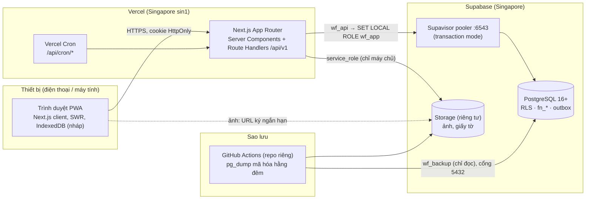

# Kiến trúc tổng thể

> Cập nhật lần cuối: 2026-10-16 · Trạng thái: Duyệt · Quyết định chi tiết: `decisions.md`

## 1. Nguyên tắc

1. **Ít thành phần phải vận hành.** Một ứng dụng Next.js trên Vercel + một dự án Supabase (PostgreSQL + Storage). Không Redis, không hàng đợi ngoài, không microservice.
2. **Quy tắc nằm trong DB.** Giao dịch nhiều bước = hàm `app.fn_*` trong một transaction; quyền xem = RLS. Backend mỏng, khó làm sai.
3. **Modular monolith.** Mỗi phân hệ là một module có ranh giới rõ; giao tiếp qua hàm DB và `domain_events` (xem `extensibility`).
4. **Tái dùng cái đã kiểm thử** từ dự án Lưu Xá (auth, db wrapper, http wrapper, migration runner, sao lưu, version/changelog).
5. **Mobile-first PWA**, tiếng Việt, mất mạng không mất việc.

## 2. Sơ đồ



Ranh giới tin cậy: (1) trình duyệt không được tin — mọi quyền kiểm lại ở API và DB; (2) ứng dụng chỉ nói chuyện với DB bằng `wf_app` (chịu RLS), nên dù có lỗi mã vẫn không đọc được cột bí mật hay ghi thẳng vào bảng giá vốn/lịch sử; (3) `service_role` của Supabase **chỉ** ở máy chủ, chỉ dùng cho Storage; (4) **Data API (PostgREST) bị tắt**, `anon`/`authenticated` bị thu hồi quyền.

## 3. Công nghệ

| Lớp | Lựa chọn | Ghi chú |
|---|---|---|
| Giao diện | Next.js (App Router, bản ổn định mới nhất khi scaffold), React, TypeScript strict, Tailwind CSS; phông **Be Vietnam Pro** (tự lưu trữ qua `@fontsource`) | Server Components cho trang đọc; client component cho form/POS; nếu Next 16 dùng `proxy.ts` thay `middleware.ts`. **Phong cách Glass** (ADR-026) + phần tử tương tác từ **Lucian UX/UI** (ADR-027): `ui-design-system` |
| Dữ liệu client | SWR (như mẫu) + hook theo phân hệ `src/lib/data/*` | Prefetch khi chạm tab |
| Kiểm tra đầu vào | Zod (cùng schema cho form và API) | DTO ở `src/lib/types/*` |
| API | Route Handlers `src/app/api/v1/**` bọc bởi `api()` | Lỗi RFC 9457 (`api-conventions`) |
| CSDL | PostgreSQL (Supabase), `pg` (node-postgres) qua pooler 6543 | Không ORM: SQL có kiểu + `fn_*`; kiểu TS viết tay/sinh bằng script (không Prisma) |
| Xác thực | Argon2id (`@node-rs/argon2`), JWT EdDSA (`jose`), TOTP | Port từ Lưu Xá |
| Tệp | Supabase Storage (bucket riêng tư) + `sharp` (xóa EXIF, thu nhỏ, WebP) | Local: `.local/storage` |
| In/xuất | `pdfmake` (PDF), `write-excel-file` (Excel), `qrcode` (QR) | Sinh phía máy chủ |
| Quét mã | `BarcodeDetector` + `@zxing/browser` dự phòng (iOS) | |
| Test | `vitest` (đơn vị), harness tích hợp `scripts/test-api` (DB thật), Playwright (e2e/mobile) | `testing-strategy` |
| CI | GitHub Actions: typecheck, build, dựng DB từ migration, test | Repo GitHub (hiện public — xem `CLAUDE.md`) |
| Triển khai | Vercel (Pro) — Preview ← `staging`, Production ← `main` | `release-process` |
| Giám sát | `/api/health`, `job_runs`, `error_events`, Vercel Analytics/Speed Insights, uptime ngoài (UptimeRobot/Better Stack) | `runbook` |
| Sao lưu | GitHub Actions + `pg_dump` + gpg; Supabase backups (Pro) | `backup-restore` |

## 4. Vòng đời một request ghi

```mermaid
sequenceDiagram
  autonumber
  participant B as Trình duyệt
  participant A as Route Handler (api())
  participant D as PostgreSQL (wf_app)
  B->>A: POST /api/v1/sales/{id}/confirm<br/>cookie + X-CSRF-Token + Idempotency-Key
  A->>A: xác thực JWT, kiểm CSRF/Origin, rate limit, Zod
  A->>A: kiểm quyền sớm (403 nhanh)
  A->>D: BEGIN; SET LOCAL ROLE wf_app; set_config(user, request_id…)<br/>(+ kiểm phiên trong cùng lượt gửi)
  A->>D: kiểm/ghi idempotency_keys
  A->>D: SELECT app.fn_confirm_sale(id, payload)
  D->>D: khóa chiếc → kiểm trạng thái/quyền/hạn mức → trừ kho<br/>→ chốt giá vốn → payments → bảo hành<br/>→ audit → domain_events
  D-->>A: kết quả hoặc lỗi WF-*
  A->>D: COMMIT
  A-->>B: 200 JSON hoặc problem+json (tiếng Việt)
  A-)A: inBackground(dispatchEvents)
```

Một vòng mạng mở đầu: `BEGIN; SET LOCAL ROLE; set_config(...); kiểm tra phiên` được ghép vào câu SQL đầu tiên. Request GET chạy `READ ONLY`, không chờ `COMMIT`. Nhiều truy vấn độc lập dùng `batch(tx, [...])`.

## 5. Cấu trúc thư mục (đích)

```
WatchFlow/
├─ CLAUDE.md · README.md · docs/
├─ db/
│  ├─ migrations/           0001_foundation.sql … (đánh số, tăng dần; DDL + dữ liệu tham chiếu)
│  └─ seed/                 demo (local/staging)
├─ scripts/
│  ├─ db/                   pg.mjs (PostgreSQL portable), migrate.mjs, bundle.mjs, backup.mjs, seed.mjs
│  ├─ env/                  gen-keys.mjs, dev-staging.mjs, bootstrap-owner.mjs
│  ├─ ops/                  create-backup-role.mjs …
│  ├─ test-api/             các bộ test tích hợp (*.mjs) + harness
│  ├─ e2e/                  Playwright (mobile 390px, a11y)
│  ├─ docs/                 gen-data-dictionary.mjs, export-guide.mjs, check-docs.mjs
│  ├─ bump-version.mjs · check-version.mjs · setup-local.mjs
├─ ops/backup-repo/         mẫu repo sao lưu riêng tư (workflow, heartbeat, storage-backup)
├─ src/
│  ├─ app/
│  │  ├─ (auth)/dang-nhap …
│  │  ├─ (app)/             layout có dock/sidebar: dong-ho, nhap-hang, ban-hang, sua-chua, bao-hanh, cong-tac-vien, bao-cao, quan-tri …
│  │  ├─ api/v1/<module>/…  Route Handlers
│  │  └─ api/{health,cron}/…
│  ├─ server/
│  │  ├─ db.ts · http.ts · errors.ts · ops.ts · pii.ts · storage.ts · events.ts
│  │  ├─ auth/              password, tokens, session, mfa, totp (port Lưu Xá)
│  │  ├─ modules/<module>.ts   iam, platform, catalog, parts, partners, purchasing, payments, sales, repairs, inventory, reports
│  │  ├─ events/handlers/   xử lý domain_events (thông báo, về sau: hóa đơn điện tử…)
│  │  ├─ cron/              daily steps
│  │  └─ pdf/               mẫu phiếu in (pdfmake)
│  ├─ lib/                  money.ts, dates.ts, permissions.ts, settings-catalog.ts, types/, data/ (hook SWR)
│  ├─ components/           ui/ (phần tử Glass dùng chung), lucian/ (phần tử Lucian đã port, kèm chú thích MIT), layout/, <module>/
│  ├─ styles/               tokens.css (token Glass + ánh xạ --ux-*), glass.css
│  ├─ content/              guide.ts (hướng dẫn), changelog.ts
│  └─ middleware.ts | proxy.ts
└─ .github/workflows/ci.yml
```

## 6. Môi trường

| | local | staging | production |
|---|---|---|---|
| URL | `http://localhost:3000` | Vercel Preview (nhánh `staging`) | Vercel Production (nhánh `main`) |
| DB | PostgreSQL portable `127.0.0.1:54329` (`embedded-postgres`, không cần Docker) | Supabase project riêng | Supabase project riêng |
| Tệp | `.local/storage` | Supabase Storage (staging) | Supabase Storage (production) |
| Khóa/bí mật | `.env.local` (sinh bởi `setup:local`) | `.env.staging` | `.env.production` |
| Dữ liệu | seed demo | seed demo + dữ liệu thử | dữ liệu thật; **không seed demo** |
| Dịch vụ ngoài | tắt/giả lập (`AI_OFFLINE=1`…) | tùy chọn | tùy chọn |

Chi tiết biến môi trường: `04-engineering/dev-setup`.

## 7. Tác vụ định kỳ (Vercel Cron, gói Pro)

| Lịch (giờ VN) | Đường dẫn | Việc |
|---|---|---|
| 07:00 hằng ngày | `/api/cron/daily?slot=morning` | Đánh dấu giữ hàng quá hạn; nhắc nợ đến hạn; bảo hành sắp hết/hết hạn; máy sửa xong chưa lấy; chiếc ở CTV quá hạn; cảnh báo linh kiện thấp & hàng tồn lâu (tạo `notifications`) |
| 19:00 hằng ngày | `/api/cron/daily?slot=evening` | Bộ kiểm bất biến (`fn_consistency_check`); dọn `idempotency_keys`/`rate_limit_hits`/phiên hết hạn; đo dung lượng; kiểm nhịp tim sao lưu |
| mỗi 10 phút | `/api/cron/events` | Xử lý `domain_events` còn tồn (bổ sung cho xử lý nền ngay sau mỗi thao tác ghi) |

Mỗi bước có hạn ~12 giây và tự ghi `job_runs`; lỗi ⇒ 500 (Vercel hiện đỏ) + thông báo chủ. Bước dùng `ctx.once(key)` để chống gửi trùng. Cron xác thực bằng `Authorization: Bearer $CRON_SECRET`.

## 8. Lưu trữ tệp

Bucket riêng tư: `unit-photos`, `repair-photos` (bằng chứng, bất biến), `documents` (giấy tờ người bán, biên bản), `branding`. Đường dẫn `<bucket>/<yyyy>/<mm>/<uuid>.<ext>`. Tải lên: trình duyệt → API (kiểm magic bytes, kích thước, quyền theo thực thể) → `sharp` (xóa EXIF GPS, thu nhỏ, WebP + thumbnail) → Storage; API trả `files.id`. Xem ảnh: API cấp URL ký ≤ 5 phút (hoặc proxy có kiểm quyền). Giới hạn thân request Vercel ~4,5 MB ⇒ ảnh lớn nén ở trình duyệt trước khi gửi, hoặc dùng URL tải lên ký trực tiếp tới Storage rồi gọi API xác nhận (phương án dự phòng, `integrations`).

## 9. Hiệu năng

- Vercel Functions và Supabase **cùng vùng Singapore**; mỗi instance serverless tối đa ~3 kết nối, đóng sau 10 giây nhàn rỗi.
- Truy vấn danh sách có phân trang và index; tìm kiếm bằng `pg_trgm` trên `search_text`.
- Header `Server-Timing` (số vòng DB, thời gian DB); `DB_TRACE=1` ở dev để in SQL.
- Mục tiêu: p95 API đọc < 400 ms, ghi (xác nhận phiếu) < 800 ms trong điều kiện bình thường; trang POS tải < 2 giây trên 4G.

## 10. Khả năng mở rộng (tóm tắt)

Thêm tính năng = thêm module theo hợp đồng (`extensibility`): bảng + `fn_*` + endpoint + màn hình + quyền + cài đặt + sự kiện + test + docs, không sửa lõi giao dịch. Các điểm cắm đã dành: hóa đơn điện tử, thông báo đẩy/email, kênh bán online, chi nhánh, AI, webhook ngân hàng; module đã hoãn (thu chi/quỹ, NCC, đổi trả, thợ) bật lại theo `extensibility` §7.
