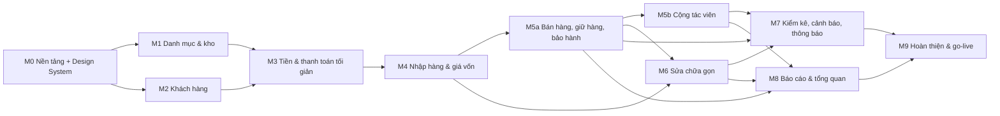

# Kế hoạch xây dựng (M0 → M9)

> Cập nhật lần cuối: 2026-10-16 · Trạng thái: Duyệt (đã cập nhật theo phản hồi khách vòng 1 + chốt giao diện Glass)
> Thứ tự theo **phụ thuộc**, không theo thời lượng (xây bằng AI nên không ước tính tháng). Mỗi mốc có **phạm vi**, **kiểm thử bắt buộc**, **Định nghĩa hoàn thành (DoD)**. Chỉ sang mốc sau khi DoD mốc trước xong và `fn_consistency_check()` sạch. Mapping FR→mốc: `requirements`. Số mốc **giữ nguyên** M0…M9; M5 tách **M5a** (bán hàng) và **M5b** (cộng tác viên); M3 đổi thành "Tiền tối giản".

## 0. Tổng quan phụ thuộc


(M5b và M6 độc lập sau M5a — có thể làm song song nếu dùng nhiều tác tử, xem §3.)

## 1. Các mốc

### M0 — Nền tảng & Design System
**Mục tiêu:** khung chạy được, an toàn, có đăng nhập–phân quyền–audit–CI–sao lưu **và hệ giao diện Glass dùng được** để mọi mốc sau chỉ việc lắp màn.
**Phạm vi:**
- Scaffold Next (App Router, TS strict, Tailwind), ESLint/Prettier, `pnpm`, `.gitignore/.vercelignore/.env.example`, `vercel.json` (`sin1`, cron), CI.
- **Port từ Lưu Xá** (đổi `luuxa_`→`wf_`, cookie `__Host-wf_*`, bỏ phần đặc thù: phụng vụ, Zalo, video, geo, cộng đoàn):
  `src/server/{db,http,errors,ops,pii,storage,outbox,jobs,activity}.ts`, `src/server/auth/*`, `scripts/db/{pg,migrate,bundle,build,sql,audit,backup}.mjs`, `scripts/env/{gen-keys,dev-staging,bootstrap-owner}.mjs`, `scripts/{setup-local,test-api,bump-version,check-version}.mjs`, `scripts/test-api/` (harness + auth + security-gates), `ops/backup-repo/*`, `.github/workflows/ci.yml`. **Không** port `FormControls` của Lưu Xá — giao diện dựng mới theo Glass.
- Migration 0001–0003 (`migrations` §2): vai trò, hàm tiện ích, IAM, platform; seed quyền/vai trò (4 vai trò)/cài đặt.
- API & UI nền: đăng nhập/đăng xuất/đổi mật khẩu/TOTP/phiên; người dùng, vai trò & quyền, cài đặt, nhật ký, tệp (tải ảnh + thumbnail + EXIF), thông báo (khung), `/api/health`, hạ tầng `domain_events` + `dispatchEvents`.
- **Design System (ADR-026/027)** — theo `ui-design-system`:
  1. `src/styles/tokens.css` (token Glass §3 + ánh xạ `--ux-*` §8.1 + khối nền `.ux` lấy từ `lucian-uxui tokens`), `src/styles/glass.css`; phông Be Vietnam Pro tự lưu trữ; Tailwind đọc token + `screens.desk=1000px`.
  2. Thành phần nền `src/components/ui/`: `GlassCard`, `StatusChip` (ánh xạ trạng thái §3), `Button`, `Field`, `MoneyInput`, `PhoneInput`, `Select`, `SegmentedControl`, `FilterChips`, `SearchBar`, `InsetList/InsetRow`, `KpiTile`, `HeroCard`, `ProductCard`, `KeyValue`, `Timeline`, `ProgressRing`, `LockNote`, `Stepper`, `BottomSheet/Modal`, `ActionSheet`, `ConfirmDialog`, `Toast`, `EmptyState`, `ErrorState`, `OfflineBanner`, `Skeleton`, `Chart` (area/bars/donut).
  3. Khung ứng dụng: `Dock` (điện thoại) + `Sidebar` đảo nổi + `TopBar` (máy tính); đăng ký điều hướng theo quyền `src/components/layout/nav.ts` (§4.3 `ui-design-system`); tiêu đề lớn mobile; vùng an toàn; PWA (manifest, icon, service worker shell cache).
  4. **Phần tử Lucian dùng ngay ở M0** (chạy `/lucian-uxui:lucian-uxui` → `search` → `get` → port, ghi sổ §9): toast (`#070`), tab phân đoạn (`#039`/`#047`), ô mã 6 số TOTP (`#026`), thẻ đăng nhập (`#062`), nhập số tiền (`#035`), trạng thái rỗng/lỗi/skeleton (`#092`/`#090`/`#079`) — **xác nhận lại bằng `search` trước khi chọn**.
  5. Trang `/dev/design` (chỉ dev/staging): bày mọi thành phần và mọi trạng thái (thường/hover/focus/disabled/lỗi/rỗng/đang tải) để rà bằng mắt và chụp ảnh nền tham chiếu.
  6. `lib/money.ts`, `lib/dates.ts`, `lib/permissions.ts`, `lib/settings-catalog.ts`.
- Phiên bản/changelog; `scripts/docs/check-docs.mjs` (bản đầu).
**Kiểm thử:** PT-07 (auth), PT-08/09 (bất biến audit), PT-10 (owner cuối), `db:audit`, `vitest` cho `money`/`dates` (allocate, làm tròn), mass-assignment; **UI: ảnh chụp 390/1366 của `/dev/design` + axe**.
**DoD:** đăng nhập được 4 vai trò demo; MFA owner; migrate ×2 sạch; `db:audit` xanh; CI xanh; deploy lên staging; `/api/health?deep=1` OK; **workflow sao lưu chạy thành công 1 lần** và diễn tập khôi phục vào DB tạm; `dev-setup` ghi lệnh thật; **`/dev/design` duyệt với khách hoặc chủ dự án (đúng mẫu v6-glass)**; sổ Lucian (§9) điền đủ phần tử đã port.

### M1 — Danh mục & kho đồng hồ, linh kiện (master)
**Phạm vi:** migration 0004 (brands, watch_models, storage_locations, watch_units (có `held_by_collaborator_id`), unit_*, part_*); màn hình loại/thương hiệu, danh sách–chi tiết chiếc (`ProductCard` lưới + `InsetList`), ảnh, thông số, phụ kiện, vị trí, lịch sử giá/trạng thái; `fn_set_unit_price`, `fn_move_unit`, `fn_release_unit`, `fn_writeoff_unit`/`restore`; tìm kiếm (trigram, không dấu, quét QR); tem QR PDF; view `v_stock_units`, `v_unit_aging`; linh kiện (danh mục, tương thích, ngưỡng) và `fn_adjust_part_stock`.
**UI/Lucian:** drawer bộ lọc (`#305`), tải ảnh (`#032`), bộ chỉnh số lượng (`#018`), copy mã (`#008`).
**Lưu ý:** chiếc **chỉ** được tạo bởi `fn_confirm_purchase` (M4, ADR-020). Trong M1–M3, chiếc được nạp bằng `db/seed` (script chạy bằng quyền chủ DB, **chỉ local/staging**, từ chối production). Sau M4, seed demo chuyển sang tạo qua phiếu nhập thật.
**Kiểm thử:** ma trận chuyển trạng thái, bất biến `status` không UPDATE trực tiếp, upload ảnh (magic bytes, EXIF), tìm kiếm không dấu/gõ sai nhẹ.
**DoD:** FR-UNIT-02…12, FR-PART-01…04/06, FR-STK-01/02/03; UAT-01 đạt trên seed; ảnh chụp 390/1366 các màn đồng hồ & linh kiện.

### M2 — Khách hàng
**Phạm vi:** migration 0005; khách hàng (CRUD, nhóm, tìm SĐT/tên, tạo nhanh, **PII mã hóa + xem có lý do + audit**, `customer_watches`), `fn_anonymize_customer`; RLS cho `customer.view_own`.
**Kiểm thử:** PT-03 (phần khách của CTV), PT-12 (PII), trùng SĐT cảnh báo, tìm kiếm.
**DoD:** FR-CUS-01/06/07, FR-BAK-05; UAT-03 (phần khách).

### M3 — Tiền & thanh toán tối giản (thay Tài chính lõi — CF-07)
**Phạm vi:** migration 0006; **`lib/money.ts` + `app.round_vnd/allocate_vnd`** (đối chiếu TS↔SQL, thuộc tính ngẫu nhiên Σ=tổng); bảng `payments`, `fn_record_payment`, `fn_void_payment`; view `v_doc_balances` (phải thu, đã trả, còn nợ, cọc đang giữ); lớp nối vào chứng từ (phiếu bán/sửa/giữ hàng/quyết toán) ở các mốc sau; UI `MoneyInput`, `PaymentSheet` (tiền mặt/chuyển khoản/kết hợp, tiền thừa).
**UI/Lucian:** nhập số tiền (`#035`) hoàn thiện; không có màn quỹ/thu chi.
**Kiểm thử:** SC-11 (làm tròn/phân bổ/bình quân), CT-05 (thu thêm song song), PT-09; không trả vượt phải thu.
**DoD:** FR-PAY-01…05 (khung), FR-COST-07 (khái niệm), UT-money xanh.

### M4 — Nhập hàng & giá vốn
**Phạm vi:** migration 0007; phiếu nhập (nháp/xác nhận/hủy) các loại `purchase` (nguồn hàng chữ), `customer_buyback`, `opening`; dòng đồng hồ/linh kiện; **chi phí liên quan + phân bổ**; **sinh chiếc + mã nội bộ**; `unit_cost_entries`; kho linh kiện + giá bình quân; `fn_adjust_unit_cost`; thu mua từ khách (giấy tờ người bán, biên bản); PDF phiếu nhập + Excel; "Nhập nhanh một chiếc"; in tem sau xác nhận; quyền `cost.view` thực thi ở RLS/view.
**UI/Lucian:** wizard/form nhiều bước (`#042`), xác nhận nguy hiểm khi hủy (`#269`/`#003`).
**Kiểm thử:** SC-01, SC-11, SC-17; CT-09, CT-12; PT-01 (phần giá vốn/phiếu nhập), `fn_consistency_check` I7–I9; nhập lại chiếc cũ (chu kỳ +1).
**DoD:** FR-PUR-01…13, FR-COST-01/02/09, FR-PART-04/06, FR-UNIT-01/06; UAT-02; seed demo chuyển sang qua phiếu nhập thật.

### M5a — Bán hàng, giữ hàng, thu cũ đổi mới, bảo hành
**Phạm vi:** migration 0008; giữ hàng/cọc; phiếu bán nháp→xác nhận (POS mobile-first, quét QR, **thông tin + giá thu + giá bán**, giảm giá theo hạn mức, thanh toán kết hợp, tiền thừa, nợ + hẹn trả, **thu thêm trên phiếu**, in phiếu); **thu cũ đổi mới**; hủy phiếu (cửa sổ 24 giờ); bán linh kiện lẻ; **bảo hành tự tạo** + tra cứu bảo hành; `sale_line_costs`; lọc "còn nợ".
**Cổng thiết kế (trước khi code POS):** bản tĩnh "Phiếu bán gọn" (thông tin + giá thu/bán) theo Glass được khách xem (`customer-feedback-01` CF-01, Q8).
**UI/Lucian:** bottom sheet giỏ nhiều độ cao (`#336`), segmented kỳ, chip bộ lọc, toast, xác nhận hủy.
**Kiểm thử:** SC-02…07, SC-13, SC-15; CT-01, CT-02, CT-03, CT-05, CT-07, CT-08; PT-01, PT-11; `fn_consistency_check` I1–I5, I8, I11; e2e POS 390px.
**DoD:** FR-SALE-01…18 (trừ 12), FR-RSV-*, FR-TRD-*, FR-WAR-01/02/05, FR-STK-04/05, FR-PAY-01/03/04/05, FR-CUS-02/04/05/08, FR-COST-04/05; UAT-03.

### M5b — Cộng tác viên (giao hàng – giá thu – hưởng chênh lệch — CF-03/08)
**Phạm vi:** migration 0008b; hồ sơ CTV; **phiếu giao** (`fn_confirm_assignment`, trạng thái `with_collaborator`, `held_by_collaborator_id`, trigger khóa giá thu); **màn hình CTV** (`/ctv/*`: hàng đang giữ, tạo đơn nháp, đơn của tôi, thống kê của tôi); **xác nhận đơn CTV** (mở rộng `fn_confirm_sale`: chốt giá thu, `shop_revenue = giá thu`); **quyết toán** (`fn_settle_collaborator`, thanh toán `collab_settlement`, hủy quyết toán); **thu hồi** / ghi mất; hủy đơn CTV; **thống kê CTV** theo tháng/quý/năm (`rpt_collaborator`); cảnh báo hàng ở CTV quá hạn.
**Cổng thiết kế (bắt buộc trước khi code):** bản tĩnh theo Glass cho **màn hình CTV, Giao hàng, Quyết toán, Thống kê CTV** được khách duyệt (các màn này chưa có trong mẫu — `ui-design-system` §6/§10) và khách xác nhận Q8–Q11, Q19.
**UI/Lucian:** biểu đồ cột đổi hình theo kỳ (`#095`), tab phân đoạn (`#039`), nhập số tiền cho giá thu (`#035`), xác nhận hủy quyết toán (`#269`).
**Kiểm thử:** SC-12, SC-16; CT-06, CT-08, CT-10; PT-02, PT-03; `fn_consistency_check` I6, I10, I11.
**DoD:** FR-COL-01…11, FR-UNIT-13, FR-COST-10, FR-SEC-07, FR-DASH-12 (dữ liệu), FR-RPT-12; UAT-11.

### M6 — Sửa chữa gọn & bảo hành sau sửa (chỉ chủ — CF-04/05)
**Phạm vi:** migration 0009; nhận máy (ảnh tùy chọn), ghi trạng thái, dòng dịch vụ/linh kiện (xác nhận dùng → trừ kho), cọc sửa, hoàn thành/giao/hủy, **sửa nội bộ vốn hóa**, bảo hành sau sửa, **nhận máy bảo hành** (phiếu `warranty_free`), lịch sử theo serial, PDF phiếu nhận/giao. **Không** có thợ, phân công, tiền công, "Việc của tôi".
**Cổng thiết kế:** bản tĩnh "Sửa chữa gọn" + "Bảo hành" theo Glass (CF-04/CF-02).
**UI/Lucian:** wizard nhận máy (`#042`), dòng thời gian trạng thái (`#087`), vòng tiến độ (`ProgressRing`), tải ảnh tùy chọn (`#032`).
**Kiểm thử:** SC-07, SC-08, SC-09; CT-04; PT-04; `fn_consistency_check` I12.
**DoD:** FR-REP-01…18 (trừ hoãn), FR-WAR-01/03, FR-COST-03, FR-PART-07/08, FR-PAY-02, FR-CUS-03; UAT-06.

### M7 — Kiểm kê, cảnh báo & thông báo
**Phạm vi:** migration 0010; kiểm kê (quét QR đếm, đối chiếu, lý do, chốt), hao hụt, `v_unit_aging`, `v_part_low_stock`, cron daily (giữ hàng quá hạn, khách hẹn trả đến hạn, bảo hành sắp hết/hết hạn, máy chưa lấy, linh kiện thấp, tồn lâu, **chiếc ở CTV quá hạn**), thông báo trong ứng dụng (chuông), `fn_consistency_check` đầy đủ + cron evening, cảnh báo sao lưu.
**UI/Lucian:** chuông thông báo (`#074`), toast, trạng thái rỗng.
**Kiểm thử:** SC-14; CT-13; chạy cron giả thời gian; I1–I12.
**DoD:** FR-STK-06…10, FR-PART-09, FR-DASH-08, FR-REP-17, FR-RSV-04, FR-WAR-04, FR-COL-11, FR-PLAT-02, FR-PLAT-04; UAT-04.

### M8 — Báo cáo & tổng quan
**Phạm vi:** migration 0011 (`rpt_*`); dashboard theo vai trò (chủ, bán hàng, kho, CTV); các báo cáo R1–R12 (`reports-and-dashboard`) với lọc ngày, Excel/PDF, quyền; trang chủ từng vai trò; **Thống kê CTV** hoàn chỉnh.
**UI/Lucian:** biểu đồ vùng có tooltip kéo (`#096`), donut (`#097`), số đổi từng chữ số (`#098`), lọc khoảng ngày (`#030`).
**Kiểm thử:** SC-10, SC-12 (thống kê), đối chiếu số liệu từng báo cáo với SC-01…09; PT-01/PT-05 (xuất file theo quyền); hiệu năng truy vấn.
**DoD:** FR-DASH-*, FR-RPT-*, FR-COST-06, FR-STK-09, FR-PAY-06; UAT-05, UAT-07.

### M9 — Hoàn thiện & go-live
**Phạm vi:** chạy **đầy đủ** CT/PT/SC; kiểm định độc lập (`/code-review`, `/security-review`, rà RLS, thử tấn công mass-assignment/đồng thời); sửa lỗi; hiệu năng & tải nhẹ; a11y; PWA & camera trên điện thoại thật; **rà phần tử Lucian** (mã, CSP, hiệu năng); **sao lưu + diễn tập khôi phục có biên bản**; hướng dẫn sử dụng theo vai trò (`src/content/guide.ts` → `docs/07-user-guide`); sinh từ điển dữ liệu & ma trận quyền; `docs:check`; thiết lập production; nhập tồn đầu kỳ; đào tạo; UAT chính thức (`uat-acceptance`); bàn giao (`runbook` §Bàn giao).
**DoD:** toàn bộ UAT-01…11 đạt; checklist go-live xong; báo cáo test phát hành lưu; chủ cửa hàng ký nghiệm thu; **các câu hỏi Q1–Q3, Q5–Q7 (vision-scope) và Q8–Q19 (feedback-01) đã có trả lời hoặc chấp nhận rủi ro bằng văn bản**.

## 2. Quy trình làm việc trong **một mốc** (với Claude Code)

1. **Chuẩn bị:** mở phiên, `CLAUDE.md` tự nạp. Dán mục mốc ở §1 + liệt kê docs liên quan (`business-rules` đoạn BR của mốc, `data-model` đoạn bảng, `integrity-and-concurrency`, `security-model`; **nếu có UI: `ui-design-system` + `ux-and-navigation`**). Yêu cầu *lập kế hoạch trước* (plan mode) rồi duyệt.
2. **Thứ tự bắt buộc:** (a) cập nhật docs nếu phát hiện thiếu/mâu thuẫn → (b) **cổng thiết kế** nếu màn chưa có trong mẫu (bản tĩnh theo Glass, khách duyệt) → (c) migration + test cấu trúc → (d) test DB/tích hợp (SC/CT/PT) viết trước hoặc cùng lúc → (e) module máy chủ + route → (f) hook + giao diện (**lấy phần tử tương tác từ Lucian theo `ui-design-system` §8; ghi sổ §9**) → (g) e2e/ảnh chụp 390 & 1366 + axe → (h) docs/guide/changelog.
3. **PR nhỏ** theo lát cắt dọc (một `fn_*` + API + màn hình + test), mỗi PR đạt DoD của `CLAUDE.md`.
4. **Đừng để AI đoán nghiệp vụ:** thiếu quy tắc ⇒ AI hỏi/ghi vào "Câu hỏi mở" (`customer-feedback-01` §4 hoặc `vision-scope` §7), không tự bịa. Số tiền luôn lấy từ `golden-scenarios`.
5. **Sau mỗi lát cắt động tới thanh toán/kho/quyền:** chạy `pnpm test:api` (SC+CT+PT liên quan) và `fn_consistency_check()`.
6. **Cuối mốc:** chạy toàn bộ test; `/code-review` và (nếu đụng bảo mật) `/security-review`; đánh `☑` các FR trong `requirements`; cập nhật `docs/README` trạng thái; tăng phiên bản; deploy staging; kiểm tay theo UAT của mốc.

### Mẫu mô tả giao việc cho AI (copy & điền)

```
Mốc: M<n> — <tên>. Làm lát cắt: <fn/ màn hình>.
Đọc trước: CLAUDE.md; docs/04-engineering/build-plan.md §M<n>; BR: <ID…>; data-model: <bảng…>; golden-scenarios: <SC…>.
UI (nếu có): docs/03-architecture/ui-design-system.md + ux-and-navigation (màn tương ứng) + design/ui-preview/v6-glass.html.
Yêu cầu: (1) lập kế hoạch ngắn rồi dừng chờ duyệt; (2) migration theo migrations.md (checklist bảng/hàm); (3) test SC/CT/PT trước;
         (4) module + route + UI mobile-first theo Glass; phần tử tương tác dùng skill /lucian-uxui:lucian-uxui (search→get→port, ghi sổ §9);
         (5) không sửa file migration cũ; (6) cập nhật docs/guide/changelog; (7) báo kết quả test + file đã đổi + danh sách phần tử Lucian đã dùng.
Ràng buộc: tiền là bigint VND; ghi nghiệp vụ qua fn_*; không secret trong code; không dựng màn đã bị loại (ui-design-system §6); mâu thuẫn docs ⇒ dừng hỏi.
```

## 3. Chạy song song nhiều tác tử (tùy chọn, sau M0)

Chỉ khi các lát cắt **không chung file**. Theo mẫu `docs/packages/*` + `BRIEF_COMMON.md` của Lưu Xá:
- Mỗi gói có **danh sách file sở hữu**; file dùng chung (`lib/permissions.ts`, `settings-catalog.ts`, `nav.ts`, `tokens.css`, sổ Lucian §9) chỉ được *thêm nhỏ* và đọc lại ngay trước khi sửa.
- Số migration **được giao trước** cho từng gói; không sửa migration đã có.
- Cấm: commit/push/stash/reset trong phiên con; chạy `build` (chỉ người điều phối); lệnh nặng bọc khóa dùng chung nếu máy ít RAM.
- Báo cáo cuối của gói: đã làm · test (x/y) · chưa làm · cần gói khác · phần tử Lucian đã dùng · đề xuất cập nhật docs/guide.
Gợi ý chia: **M5b** (CTV) ∥ **M6** (sửa chữa) sau M5a.

## 4. Cổng kiểm soát trước khi sang mốc kế

| Cổng | Điều kiện |
|---|---|
| G1 Docs | BR/SC của mốc đã đủ, FR đánh dấu, không mâu thuẫn; `docs:check` xanh |
| **G1b Thiết kế** | Màn chưa có trong mẫu đã có bản tĩnh Glass được duyệt (M5a, M5b, M6; M0 cho đăng nhập) |
| G2 DB | `db:audit` xanh; migrate ×2 sạch; RLS+FORCE mọi bảng mới |
| G3 Test | SC/CT/PT của mốc xanh; `vitest` xanh; `fn_consistency_check()` sạch |
| G4 Bảo mật | Không endpoint mới lộ trường nhạy cảm (PT); không bí mật trong repo; phần tử Lucian đã rà |
| G5 UX | Kiểm tay trên điện thoại thật (hoặc 390px) cho luồng chính; ảnh chụp 390/1366; axe; tương phản AA |
| G6 Triển khai | Đã chạy trên staging; changelog; phiên bản tăng |

## 5. Rủi ro theo mốc & cách giảm

| Rủi ro | Mốc | Giảm |
|---|---|---|
| Auth port thiếu test ⇒ lỗ hổng | M0 | Port kèm bộ test; PT-07; xoay khóa; review `/security-review` |
| Quyền Supabase (BYPASSRLS, tạo role) khác kỳ vọng | M0 | Kiểm sớm trên staging ở M0; phương án `SET ROLE` thay vì `BYPASSRLS` (`migrations` §3) |
| Giao diện Glass nặng (blur) trên máy yếu | M0, M9 | Blur chỉ ở khối nổi; dự phòng `@supports`; kiểm CPU throttle 4× |
| Phần tử Lucian không khớp Glass/CSP | M0+ | Ánh xạ token; port theo `porting.md`; không nới CSP; tự dựng nếu không khớp |
| Làm tròn sai lệch 1 đồng | M3, M4, M5a | `allocate` có test thuộc tính; đối chiếu TS↔SQL |
| POS chậm trên điện thoại | M5a | Danh sách ảo hóa, tìm kiếm server, bundle nhỏ, e2e đo |
| Hai CTV/một chiếc, bán vs giao trùng | M5b | CT-06 trước khi làm UI; unique một phần + khóa chiếc |
| Khách đổi yêu cầu CTV/giá thu | M5b | Cổng thiết kế + xác nhận Q8–Q11 trước khi code |
| Phạm vi sửa chữa làm vỡ kho linh kiện | M6 | CT-04 trước khi làm UI; khóa dòng linh kiện |
| Báo cáo lệch định nghĩa | M8 | Mọi báo cáo dùng `rpt_*` đã có SC đối chiếu; dashboard = cùng hàm |
| Quên diễn tập khôi phục | M0, M9 | Cổng DoD M0 và M9 bắt buộc biên bản |
