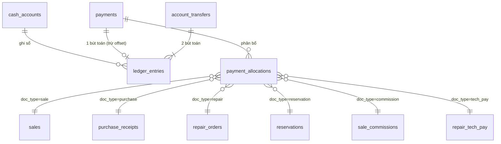

# Tiền, thanh toán, công nợ & sổ quỹ

> Cập nhật lần cuối: 2026-10-16 · Trạng thái: Duyệt · Quy tắc gốc: BR-FIN-*, BR-SALE-05/06, BR-RSV-*, BR-TRD-*

## 1. Nguyên lý (đọc kỹ — mọi thứ khác suy ra từ đây)

1. **Chứng từ nói "ai nợ ai bao nhiêu"** (phiếu bán, phiếu nhập, phiếu sửa). **Thanh toán nói "tiền đi đâu"**. Hai lớp này nối với nhau bằng `payment_allocations`.
2. **Doanh thu tính từ chứng từ, không từ thanh toán** (BR-FIN-04). Nhờ vậy vay, thu hộ, cọc, hoàn tiền không thể lọt vào doanh thu.
3. **`payments` là nguyên liệu tiền duy nhất.** Tiền thật đi qua quỹ (`method` = `cash`/`bank_transfer`) ⇒ có đúng một bút toán sổ quỹ. Việc "chuyển giá trị không qua quỹ" (thu cũ đổi mới, chuyển cọc vào phiếu bán, tịch thu cọc) dùng `method='offset'` và **luôn đi theo cặp vào–ra**, không tạo bút toán quỹ.
4. **Sổ quỹ chỉ ghi thêm** (append-only, chuỗi băm). Sai ⇒ bút toán đảo.
5. Không cache số "đã trả/còn nợ" trong bảng chứng từ — **luôn tính từ allocations** (view), để không thể lệch.

## 2. Mô hình dữ liệu tiền (rút gọn)

`payments`: `direction` (in/out), `purpose`, `method` (cash/bank_transfer/offset), `account_id` (bắt buộc nếu không offset), `amount > 0`, `paid_at`/`doc_date`, `party_type` (customer/supplier/user/none) + `party_id`, `status` (posted/voided), `expense_category_id` (nếu `purpose='expense'`), `offset_kind` (nếu offset).

### 2.1 Danh mục `purpose`

| Hướng | purpose | Ý nghĩa | Phân bổ vào | Là doanh thu? | Tính vào "thực thu/thực chi"? |
|---|---|---|---|---|---|
| in | `sale_receipt` | Khách trả tiền phiếu bán (kể cả thu nợ sau) | `sale` | Không (doanh thu tính từ phiếu) | Thực thu |
| in | `repair_receipt` | Khách trả phiếu sửa (kể cả cọc sửa) | `repair` | Không | Thực thu |
| in | `deposit_receipt` | Cọc giữ hàng | `reservation` | Không | Thực thu (hiển thị riêng "cọc") |
| in | `other_income` | Thu nhập khác | — | Không | Thực thu (nhóm khác) |
| in | `loan_in` | Khoản vay | — | **Không bao giờ** | Có tiền vào quỹ nhưng **không** tính thực thu bán/sửa |
| in | `third_party_in` | Thu hộ | — | **Không bao giờ** | idem |
| in | `offset_in` | Bù trừ (vào) | tùy `offset_kind` | Không | **Không** (không qua quỹ) |
| out | `purchase_payment` | Trả tiền phiếu nhập (NCC / người bán) | `purchase` | — | Thực chi |
| out | `refund` | Hoàn tiền đổi trả | `sale` | — | Thực chi |
| out | `deposit_refund` | Hoàn cọc | `reservation` | — | Thực chi |
| out | `expense` | Chi phí hoạt động | — | — | Thực chi |
| out | `commission_payout` | Trả hoa hồng CTV | `commission` | — | Thực chi |
| out | `technician_payout` | Trả tiền công thợ | `tech_pay` | — | Thực chi |
| out | `loan_repay` / `third_party_out` | Trả nợ vay / trả tiền thu hộ | — | — | Không thuộc chi phí hoạt động |
| out | `other_out` | Chi khác | — | — | Thực chi |
| out | `offset_out` | Bù trừ (ra) | tùy `offset_kind` | — | **Không** |

`offset_kind`: `trade_in` · `deposit_applied` · `forfeited_deposit`.

## 3. Công thức công nợ (view `v_doc_balances`)

Với mỗi chứng từ:

- `paid_net = Σ allocations từ payment(in) − Σ allocations từ payment(out)` (cả `offset` đều tính vì đây là thanh toán).
- **Phiếu bán**: `net_total = grand_total − Σ giá trị đổi trả đã xác nhận`; `due = net_total − paid_net`. `due > 0` = khách nợ; `due < 0` = cửa hàng phải hoàn (sau đổi trả).
- **Phiếu nhập**: `due = grand_total − paid_net` (payment `out` cộng, payment `in` hoàn lại từ NCC trừ).
- **Phiếu sửa**: trước `delivered`, `paid_net` = tiền đã nhận (cọc) — là *khoản nhận trước*; sau `delivered`, `due = tổng phải thu − paid_net`.
- **Giữ hàng**: `cọc đang giữ = Σ in(deposit_receipt, offset_in) − Σ out(deposit_refund, offset_out)` phân bổ vào giữ hàng.

Tổng hợp:
- **Công nợ khách** = Σ `max(due, 0)` các phiếu bán `confirmed` + phiếu sửa `delivered` của khách.
- **Cọc/tiền nhận trước đang giữ** của khách = Σ cọc giữ hàng còn lại + Σ `paid_net` phiếu sửa chưa giao.
- **Công nợ NCC** = Σ `max(due, 0)` các phiếu nhập `confirmed` (`supplier`, `customer_buyback`).

## 4. Các dòng chảy chuẩn (ví dụ có số)

### 4.1 Bán thường, thanh toán kết hợp (SC-02)
Phiếu bán `grand_total = 8.200.000`. Khách trả 5.000.000 tiền mặt + 3.200.000 chuyển khoản.
- Hai `payments(in, sale_receipt)`: 5.000.000 (quỹ tiền mặt), 3.200.000 (quỹ ngân hàng), cùng phân bổ vào phiếu bán.
- Hai bút toán sổ quỹ (+5.000.000 tiền mặt; +3.200.000 ngân hàng). `paid_net = 8.200.000`, `due = 0`.

### 4.2 Bán có tiền thừa (SC-03)
Phiếu `6.500.000`, khách đưa 7.000.000 tiền mặt. `payments(in)` = **6.500.000** (không phải 7.000.000). `cash_tendered=7.000.000` lưu để in "tiền thừa 500.000". Sổ quỹ chỉ +6.500.000.

### 4.3 Bán nợ & thu nợ (SC-04)
Phiếu `1.800.000`, khách trả 500.000 tiền mặt ⇒ `due = 1.300.000`, `due_date` đặt. Sau đó khách trả 1.000.000 chuyển khoản qua "Thu nợ": một `payment(in, sale_receipt)` phân bổ vào phiếu (mặc định phiếu cũ trước) ⇒ `due = 300.000`.

### 4.4 Cọc → bán (SC-05)
1. Giữ hàng chiếc D, cọc 2.000.000 tiền mặt: `payment(in, deposit_receipt)` phân bổ vào giữ hàng. **Cọc đang giữ = 2.000.000. Doanh thu = 0.**
2. Bán, `grand_total = 13.500.000`. Chuyển cọc: cặp bù trừ `offset_out(deposit_applied)` phân bổ **vào giữ hàng** (cọc còn 0) và `offset_in(deposit_applied)` 2.000.000 phân bổ **vào phiếu bán**. Khách trả thêm 11.500.000 ⇒ `paid_net = 13.500.000`. Sổ quỹ tổng +2.000.000 (lúc cọc) +11.500.000.

### 4.5 Hủy giữ (SC-05, nhánh phụ)
- **Hoàn cọc**: `payment(out, deposit_refund)` 2.000.000 thật, phân bổ vào giữ hàng ⇒ cọc 0; sổ quỹ −2.000.000.
- **Tịch thu**: `offset_out(forfeited_deposit)` 2.000.000 phân bổ vào giữ hàng + `offset_in(forfeited_deposit)` 2.000.000 *không phân bổ* (ghi vào "thu nhập khác"). Không có bút toán quỹ mới (tiền đã nằm trong quỹ từ lúc cọc).

### 4.6 Thu cũ đổi mới (SC-06)
Phiếu bán `20.000.000`; máy cũ thu giá 6.000.000; khách chuyển khoản 14.000.000.
- Phiếu nhập `trade_in` 6.000.000 (xác nhận cùng transaction). 
- Cặp bù trừ `offset_in(trade_in)` 6.000.000 → phân bổ phiếu bán; `offset_out(trade_in)` 6.000.000 → phân bổ phiếu nhập.
- `payment(in, sale_receipt, bank)` 14.000.000 → phiếu bán.
- Kết quả: bán `due=0`; nhập `due=0`; **quỹ chỉ +14.000.000**; doanh thu 20.000.000.

### 4.7 Đổi trả (SC-07)
Phiếu đã thu đủ 8.200.000, trả toàn bộ ⇒ `net_total=0`. Hoàn tiền = `paid_net − net_total` = 8.200.000 (tối đa, BR-RET-05): `payment(out, refund)` phân bổ vào **phiếu bán** (có thể tách tiền mặt/ngân hàng). `paid_net` về 0, `due=0`.
Nếu phiếu còn nợ (`paid_net` < `grand_total`), đổi trả trước hết giảm nợ: `net_total` giảm ⇒ `due` giảm; chỉ hoàn phần `paid_net − net_total` nếu dương.

### 4.8 Sửa chữa có cọc (SC-08)
Cọc 200.000 tiền mặt lúc nhận: `payment(in, repair_receipt)` phân bổ vào phiếu sửa. Giao máy, tổng 900.000: khách trả thêm 700.000 chuyển khoản. Doanh thu sửa chữa 900.000 ghi nhận lúc `delivered`; `due=0`.

### 4.9 Khoản vay / thu hộ (SC-13)
`payment(in, loan_in)` 50.000.000 vào quỹ ngân hàng: số dư quỹ tăng, **doanh thu và thực thu bán/sửa không đổi**. Báo cáo thu chi hiển thị riêng dòng "Vay / thu hộ".

## 5. Sổ quỹ (`ledger_entries`)

Mỗi quỹ (`cash_accounts`) có một chuỗi bút toán tuần tự:

| Cột | Ý nghĩa |
|---|---|
| `seq` | Số thứ tự trong quỹ, liên tục (1,2,3…) |
| `entry_date` | Ngày VN của bút toán |
| `direction`, `amount` | `in`/`out`, > 0 |
| `payment_id` / `transfer_id` | Nguồn (đúng một) |
| `reverses_entry_id` | Nếu là bút toán đảo |
| `entry_kind` | `normal` · `reversal` · `adjustment` · `opening` |
| `balance_after` | Số dư sau bút toán (đã tính cả bút toán này) |
| `prev_hash`, `hash` | `hash = sha256(prev_hash ‖ account_id ‖ seq ‖ direction ‖ amount ‖ entry_date ‖ ref ‖ created_at)` |

Ghi sổ qua `fn_post_ledger_entry`:
1. Khóa dòng `cash_accounts` (`FOR UPDATE`), đọc entry cuối (`seq`, `balance_after`, `hash`).
2. Kiểm kỳ của `entry_date` đang mở (BR-GEN-07).
3. Tính `balance_after`; nếu < 0 và quỹ không cho âm ⇒ lỗi `WF-FIN-NEGATIVE-CASH`.
4. Chèn bút toán với `seq+1` và hash nối chuỗi.
Trigger chặn `UPDATE/DELETE/TRUNCATE`. Hàm `fn_verify_ledger_chain(account_id)` kiểm toàn chuỗi, chạy hằng đêm (kết quả lỗi = **sự cố nghiêm trọng**, thông báo chủ).

### 5.1 Số dư đầu kỳ
Mỗi quỹ có bút toán `opening` đầu tiên (BR-FIN-13) do chủ nhập một lần với ngày bắt đầu sổ.

### 5.2 Chuyển quỹ
`fn_transfer_between_accounts(from, to, amount, date)`: khóa **cả hai** quỹ theo thứ tự id tăng, ghi hai bút toán `transfer_id` chung. Không là thu/chi trong báo cáo.

### 5.3 Điều chỉnh quỹ
Kiểm tiền mặt thực tế lệch sổ ⇒ `fn_adjust_ledger(account, direction, amount, reason)` (BR-FIN-12), `entry_kind='adjustment'`. Báo cáo thu chi liệt kê riêng "Điều chỉnh".

### 5.4 Hủy phiếu thu/chi
`fn_void_payment(payment_id, reason)`: tạo bút toán đảo (`reverses_entry_id`, cùng số tiền ngược hướng), đặt `payments.status='voided'`, đánh dấu allocations vô hiệu (view loại trừ). Không thực hiện nếu kỳ đã khóa hoặc hệ quả chứng từ không cho phép (vd. phiếu bán đã hủy thì payment được đảo cùng).

## 6. Khóa kỳ & đối chiếu

- Kỳ = tháng. Trạng thái trong `financial_periods` (tạo hàng khi tháng đầu tiên có giao dịch; tháng thiếu hàng mặc định `open`).
- **Đối chiếu** (`account_reconciliations`): với mỗi quỹ và kỳ, hệ thống tính `đầu kỳ + Σ vào − Σ ra = cuối kỳ`, so với số dư thực chủ nhập (kiểm két/sao kê). Lệch ⇒ bút toán điều chỉnh có lý do.
- **Khóa kỳ** (`fn_close_period`): yêu cầu mọi quỹ đã đối chiếu và `fn_verify_ledger_chain` đạt. Sau khóa: không tạo/hủy/sửa chứng từ & payment có ngày trong kỳ; báo cáo kỳ đó là bất biến.
- **Race với ghi sổ**: `fn_close_period` và `fn_post_ledger_entry` cùng khóa dòng quỹ theo thứ tự id trước khi đọc trạng thái kỳ ⇒ không có bút toán lọt vào kỳ vừa khóa (CT-06; lỗi tương tự từng xảy ra ở dự án mẫu).
- Mở lại kỳ: `period.reopen` + lý do, audit; báo cáo của kỳ được đánh dấu "đã mở lại".

## 7. Tiền công thợ, hoa hồng (khoản phải trả nội bộ)

- `repair_tech_pay` (mỗi phiếu sửa `delivered`, mỗi thợ): `amount` chốt theo BR-REP-08, `status` pending → paid.
- `sale_commissions`: `amount` chốt khi bán, `status` pending → payable → paid (BR-COM-*).
- Chi trả gộp nhiều dòng trong một phiếu chi (`purpose` = `technician_payout`/`commission_payout`), phân bổ vào từng dòng.
- `salary` mode: `amount=0`, chỉ ghi số ca; lương trả ngoài hệ thống (hoặc phiếu chi `expense`, hạng mục "Lương").
