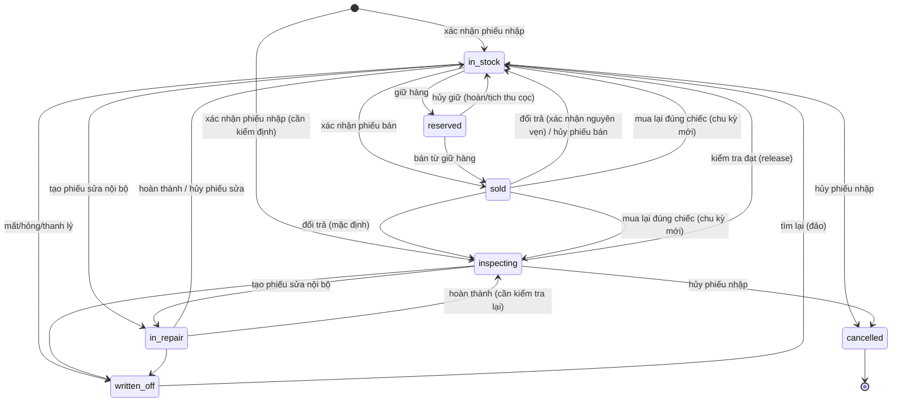
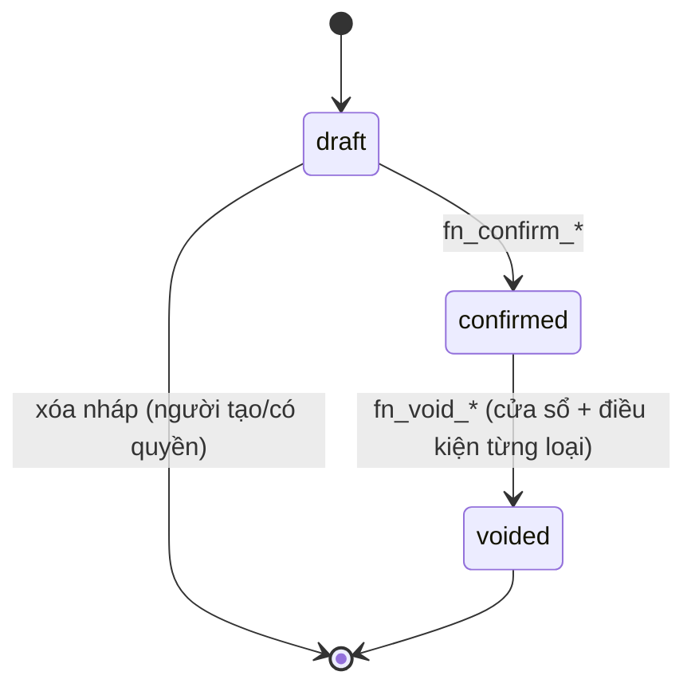
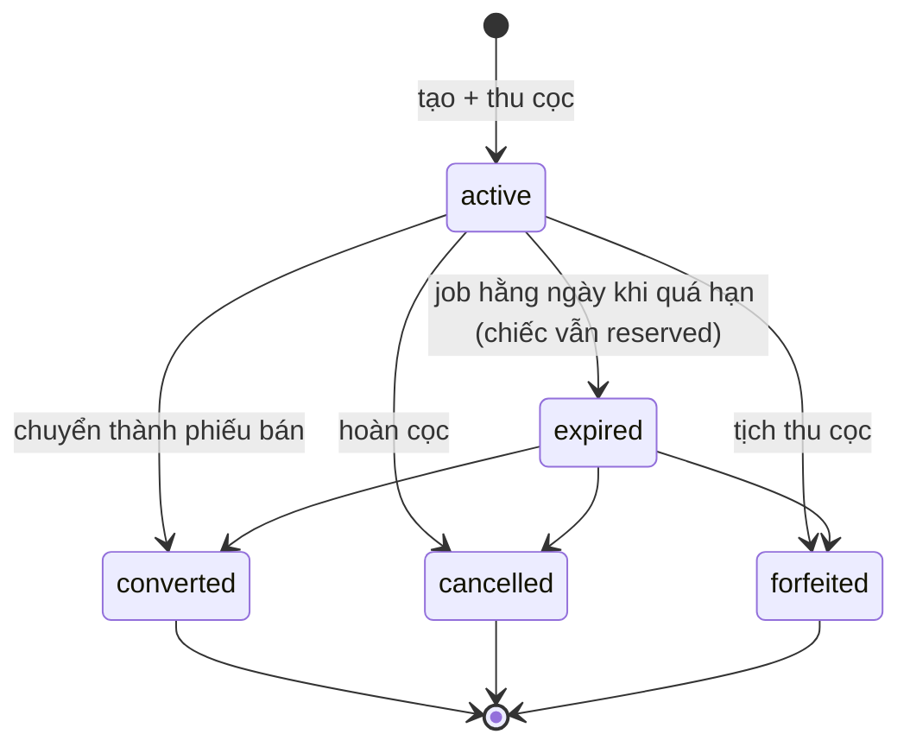
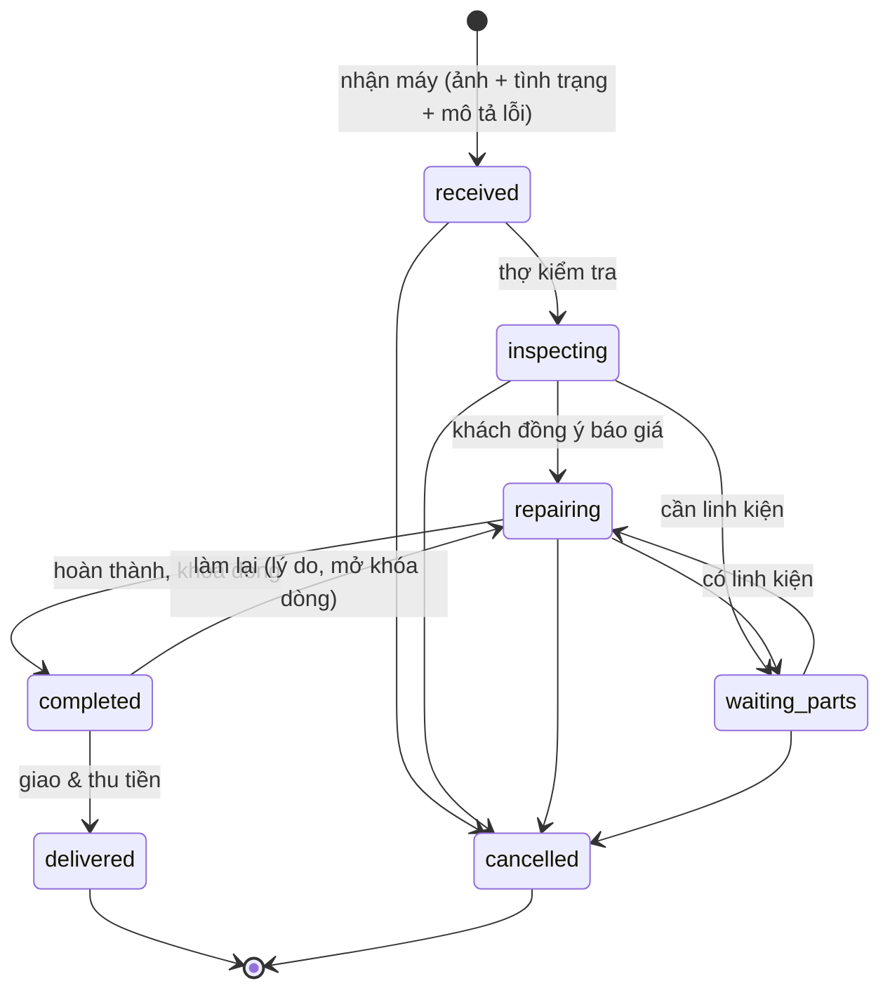

# Trạng thái & chuyển trạng thái

> Cập nhật lần cuối: 2026-10-16 · Trạng thái: Duyệt
> Mọi chuyển trạng thái **chỉ** xảy ra qua hàm `app.fn_*` nêu ở cột "Hàm". Cột `status` không có quyền `UPDATE` cho `wf_app`; trigger kiểm ma trận ở đây (`app.unit_transition_allowed`) làm lớp phòng thủ thứ hai. Mỗi chuyển ghi `*_status_history` (append-only).

## 1. Đồng hồ (`watch_units.status`)

| Từ → Đến | Hàm | Quyền | Điều kiện / ghi chú |
|---|---|---|---|
| ∅ → `in_stock` / `inspecting` | `fn_confirm_purchase` | `purchase.confirm` | Theo `initial_status` của dòng; hàng cũ phải đủ BR-UNIT-10 |
| `sold` → `in_stock` / `inspecting` | `fn_confirm_purchase` | `purchase.confirm` | Mua lại đúng chiếc: `cost_cycle + 1` (BR-PUR-10) |
| `in_stock` → `reserved` | `fn_create_reservation` | `reservation.manage` | Có cọc ≥ mức tối thiểu; unique một giữ hàng hiệu lực/chiếc |
| `reserved` → `in_stock` | `fn_cancel_reservation` | `reservation.manage` (+ `reservation.forfeit` nếu tịch thu) | Hoàn cọc hoặc tịch thu |
| `in_stock` → `sold` | `fn_confirm_sale` | `sale.confirm` | Khóa chiếc `FOR UPDATE`; kiểm trạng thái |
| `reserved` → `sold` | `fn_confirm_sale` (từ giữ hàng) | `sale.confirm` | Chỉ giữ hàng của chính khách/phiếu |
| `sold` → `inspecting` / `in_stock` | `fn_confirm_return` | `return.confirm` (+ `unit.release` để thẳng `in_stock`) | BR-RET-03 |
| `sold` → `in_stock` | `fn_void_sale` | `sale.void` | Trong cửa sổ hủy; BR-SALE-10 |
| `inspecting` → `in_stock` | `fn_release_unit` | `unit.release` | Ghi lý do/biên bản kiểm tra |
| `in_stock`/`inspecting` → `in_repair` | `fn_create_repair` (internal) | `repair.create` | BR-REP-11 |
| `in_repair` → `in_stock`/`inspecting` | `fn_complete_repair` / `fn_cancel_repair` | `repair.update` | Vốn hóa chi phí khi `completed` |
| → `written_off` | `fn_writeoff_unit`, `fn_reconcile_stocktake` | `stock.writeoff` | Lý do bắt buộc; hao hụt = giá vốn |
| `written_off` → `in_stock` | `fn_restore_unit` | `stock.writeoff` | Tìm lại; lý do bắt buộc |
| `in_stock`/`inspecting` → `cancelled` | `fn_void_purchase` | `purchase.void` | BR-PUR-07; trạng thái cuối |

**Không có đường**: `reserved → in_repair/written_off` (phải hủy giữ trước), `sold → written_off` (phải đổi trả trước), `cancelled → *`.

Ánh xạ nhãn tiếng Việt: Sẵn sàng bán · Đã giữ · Đã bán · Đang sửa · Chờ kiểm tra · Thanh lý/mất · Nhập nhầm.

## 2. Chứng từ có nháp (phiếu nhập, phiếu bán, đổi trả)

- `draft`: sửa/xóa tự do; **không giữ hàng, không ghi tiền**.
- `confirmed`: bất biến. Mọi sửa sai đi qua `voided`, đổi trả, điều chỉnh.
- `voided`: giữ lại để tra cứu, loại khỏi mọi báo cáo doanh thu/kho; đã có bút toán đảo tương ứng.
- Phiếu `sales.status='draft'` do CTV tạo hiển thị cho CTV (chỉ của họ) và cho nhân viên bán hàng.
- Điều kiện hủy từng loại: phiếu nhập → BR-PUR-07; phiếu bán → BR-SALE-10; đổi trả → chỉ khi chưa hoàn tiền (hoặc hoàn tiền phải đảo trước) và kỳ chưa khóa.

## 3. Giữ hàng (`reservations.status`)

Ràng buộc: unique một phần `(unit_id) WHERE status IN ('active','expired')`. Cọc đang giữ = Σ phiếu thu cọc phân bổ vào giữ hàng − Σ phiếu chi/bù trừ ra khỏi giữ hàng (`money-and-ledger` §Cọc).

## 4. Phiếu sửa chữa (`repair_orders.status`)

| Chuyển | Hàm | Quyền | Hiệu ứng chính |
|---|---|---|---|
| tạo → `received` | `fn_create_repair` | `repair.create` | Ảnh hiện trạng bắt buộc; internal: chiếc → `in_repair` |
| `received` → `inspecting` | `fn_set_repair_status` | `repair.update` | Gán thợ (`repair.assign`) |
| `inspecting` → `repairing` | idem | `repair.update` | Cần `quote_approved_at` [`repair.require_quote_approval`] |
| → `waiting_parts` / quay lại | idem | `repair.update` | Ghi lý do chờ |
| → `completed` | `fn_complete_repair` | `repair.update` | **Trừ kho linh kiện đã xác nhận**; khóa dòng; internal: vốn hóa vào giá vốn chiếc |
| `completed` → `repairing` | `fn_set_repair_status` | `repair.update` + lý do | Hoàn lại kho phần bỏ; mở khóa |
| `completed` → `delivered` | `fn_deliver_repair` | `repair.deliver` | Ghi doanh thu, tiền công thợ, bảo hành; thu tiền/ghi nợ |
| → `cancelled` | `fn_cancel_repair` | `repair.update` + lý do | Hoàn linh kiện & cọc (BR-REP-15) |

Phiếu `warranty_free` đi cùng luồng nhưng khi `delivered` không phát sinh doanh thu; chi phí linh kiện/công tính vào chi phí bảo hành.

## 5. Các đối tượng khác

| Đối tượng | Trạng thái | Chuyển |
|---|---|---|
| `payments.status` | `posted → voided` | `fn_void_payment` (đảo bút toán, BR-FIN-10) |
| `account_transfers.status` | `posted → voided` | `fn_void_transfer` |
| `stocktakes.status` | `open → reconciled` / `open → cancelled` | `fn_reconcile_stocktake` / `fn_cancel_stocktake` |
| `sale_commissions.status` | `pending → payable → paid`; `pending/payable → voided`; `paid` + hủy ⇒ thêm dòng clawback âm | `fn_*` trong bán/đổi trả/chi hoa hồng |
| `warranties.status` | `active → expired` (job) · `active → voided` (hủy/đổi trả) | |
| `financial_periods.status` | `open → closed → open` (mở lại có quyền + lý do) | `fn_close_period` / `fn_reopen_period` |
| `users.status` | `active ⇄ locked` (tự khóa tạm) · `active → disabled` | `server/auth`, `fn_set_user_status` |
