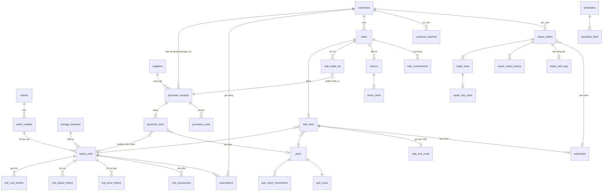

# Mô hình dữ liệu

> Cập nhật lần cuối: 2026-10-16 · Trạng thái: Duyệt · Đây là **thiết kế**; DDL thật nằm ở `db/migrations/` và là nguồn sự thật cuối cùng cho kiểu cột (từ điển cột sinh tự động ở M9: `scripts/docs/gen-data-dictionary.mjs`). Mâu thuẫn giữa file này và migration ⇒ sửa file này trong cùng PR.

## 1. Quy ước

| Hạng mục | Quy ước |
|---|---|
| Tên | Bảng `snake_case` số nhiều tiếng Anh; cột `snake_case`; bảng đối chiếu VN: `glossary` §4 |
| Khóa chính | `id uuid DEFAULT app.uuid_v7()` (UUID v7 — sắp xếp theo thời gian); riêng `number_sequences`, `settings`, `permissions`, `financial_periods` có khóa tự nhiên |
| **Tiền** | `bigint`, hậu tố `_vnd` (docs bỏ hậu tố cho gọn: `amount` = `amount_vnd`). Giá vốn bình quân linh kiện `numeric(14,4)` (`avg_cost`) |
| Số lượng | `integer` (linh kiện đếm theo cái/bộ); đồng hồ luôn 1 |
| Thời gian | `timestamptz` (UTC); ngày chứng từ `doc_date date` (ngày VN) |
| Trạng thái/loại | `text` + `CHECK (... IN (...))` (không dùng ENUM Postgres — dễ sửa bằng migration, dễ sinh kiểu). Danh sách giá trị ghi ở bảng dưới |
| Cột chung | `created_at`, `created_by`; bảng chỉnh sửa được: `updated_at`, `updated_by`, `version int` (khóa lạc quan, `If-Match`) |
| Xóa | Không xóa cứng dữ liệu nghiệp vụ (BR-GEN-03): `is_active` / trạng thái `voided`; FK `ON DELETE RESTRICT` |
| Tìm kiếm | Cột `search_text` (đã `unaccent` + hạ chữ, trigger cập nhật) + GIN `gin_trgm_ops`; `phone_norm` (chỉ chữ số) |
| Extension | `pgcrypto`, `citext`, `pg_trgm`, `unaccent` (kiểm tra Supabase cho phép; xem `migrations`) |
| Chuẩn hóa serial | `serial_norm = upper(regexp_replace(serial_no, '[\s\-_/.]', '', 'g'))` |
| Index | **Mọi FK có index**; cột lọc ngày (`doc_date`, `paid_at`, `entry_date`, `delivered_at`); trạng thái; partial unique cho bất biến nghiệp vụ |

Dưới đây `PK`, `FK→`, `U` (unique), `C` (check), `ix` (index). `RLS` ghi quyền đọc chính (chi tiết `security-model` §5).

## 2. Sơ đồ quan hệ (lõi)

## 3. Nền tảng & IAM

| Bảng | Cột chính | Ràng buộc / index | RLS |
|---|---|---|---|
| `users` | `email citext U`, `phone`, `full_name`, `password_hash`, `status` (`active\|locked\|disabled`), `must_change_password`, `mfa_enabled`, `failed_login_count`, `locked_until`, `last_login_at`, `email_verified_at` | C status; `wf_auth` ghi các cột auth | Tự đọc; `user.manage` đọc/ghi |
| `roles` | `code U`, `name_vi`, `is_system`, `max_discount_pct numeric(5,2)` (0–100), `is_active` | C 0≤pct≤100 | `role.manage` ghi; đọc cho người đăng nhập (để hiển thị) |
| `permissions` | `code PK`, `module`, `name_vi`, `description`, `is_sensitive` | seed qua migration | đọc mọi người |
| `role_permissions` | `role_id FK→`, `permission_code FK→` | PK(role_id, permission_code) | `role.manage` ghi |
| `user_roles` | `user_id FK→`, `role_id FK→` | PK(user_id, role_id); trigger bảo đảm ≥ 1 owner (BR-SEC-07) | `user.manage` |
| `auth_sessions` | `id`, `user_id`, `created_at`, `last_seen_at`, `revoked_at`, `user_agent`, `ip_hash` | ix(user_id) | `wf_auth` |
| `refresh_tokens` | `session_id`, `token_hash U`, `expires_at`, `rotated_at`, `replaced_by`, `reuse_detected_at` | ix(session_id) | `wf_auth` |
| `user_mfa` | `user_id PK`, `totp_secret_enc`, `enabled_at`, `recovery_codes_hash[]` | | `wf_auth` |
| `collaborator_profiles` | `user_id PK`, `commission_mode` (`percent_of_price\|percent_of_profit\|fixed_per_unit`), `commission_value bigint/numeric` (% hoặc VND), `note` | C value ≥ 0 | `user.manage`; CTV đọc dòng của mình (không đổi) |
| `technician_profiles` | `user_id PK`, `pay_mode` (`percent\|fixed_per_service\|salary`), `pay_percent numeric(5,2)`, `note` | | `user.manage`; thợ đọc của mình |
| `technician_rates` | `technician_user_id`, `service_type_id`, `amount_vnd` | PK(technician_user_id, service_type_id) | idem |

## 4. Nền tảng hệ thống

| Bảng | Cột chính | Ghi chú |
|---|---|---|
| `settings` | `key PK`, `value jsonb`, `description`, `updated_by`, `updated_at` | Danh mục khóa: `settings-catalog`; audit khi đổi |
| `audit_logs` | `id`, `at`, `actor_id`, `action`, `entity_table`, `entity_id`, `reason`, `before jsonb`, `after jsonb`, `request_id`, `ip_hash` | **Append-only** (trigger); ix(entity_table, entity_id, at), ix(actor_id, at), ix(at). Ít dữ liệu nên **không phân vùng** (tránh lỗi job phân vùng đã gặp ở dự án mẫu); xem lại nếu > 5 triệu dòng |
| `number_sequences` | `code`, `year`, `last_value` | PK(code, year); cấp mã bằng `INSERT … ON CONFLICT DO UPDATE … RETURNING` trong transaction (BR-GEN-06) |
| `files` | `id`, `bucket`, `path U`, `original_name`, `mime`, `size_bytes`, `sha256`, `kind` (`product\|condition\|intake\|evidence\|id_document\|logo\|other`), `entity_table`, `entity_id`, `is_immutable`, `created_by`, `created_at` | Metadata tệp ở Supabase Storage; `intake`/`evidence`/`id_document` bất biến; quyền đọc theo thực thể |
| `domain_events` | `id`, `type`, `payload jsonb`, `occurred_at`, `available_at`, `processed_at`, `attempts`, `last_error` | **Outbox**: `fn_*` chèn sự kiện cùng transaction; worker xử lý (`extensibility`) |
| `notifications` | `id`, `user_id`, `type`, `title`, `body`, `link`, `created_at`, `read_at` | Trong ứng dụng; người nhận đọc của mình |
| `job_runs` | `id`, `job`, `slot`, `started_at`, `finished_at`, `status`, `note` | Lịch sử cron |
| `error_events` | `fingerprint`, `source`, `route`, `code`, `message`, `count`, `first_seen`, `last_seen`, `request_id` | Lỗi gộp |
| `rate_limit_hits` | `key_hash`, `window_start`, `count` | PK(key_hash, window_start) |
| `idempotency_keys` | `key`, `user_id`, `route`, `request_hash`, `response jsonb`, `status_code`, `created_at` | PK(key, user_id); TTL 48 giờ dọn bởi job |
| `app_migrations` | `name PK`, `sha256`, `applied_at` | Do `scripts/db/migrate.mjs` ghi |

## 5. Catalog — danh mục & đồng hồ

| Bảng | Cột chính | Ràng buộc / index | RLS |
|---|---|---|---|
| `brands` | `name U`, `country`, `is_active` | | `catalog.view` đọc; `catalog.manage` ghi |
| `watch_models` | `code U` (mã sản phẩm), `brand_id`, `name`, `reference_no`, `caliber` (mã máy), `movement_type` (`automatic\|manual\|quartz\|solar\|smart\|other`), `case_size_mm`, `case_material`, `strap_type`, `dial_color`, `glass_type`, `water_resistance_m`, `gender` (`male\|female\|unisex`), `origin_country`, `specs jsonb`, `description`, `is_active`, `search_text` | ix(brand_id); GIN(search_text) | idem |
| `storage_locations` | `name`, `kind` (`safe\|cabinet\|display\|workshop\|other`), `note`, `is_active` | U(name) | `catalog.view` / `location.manage` |
| `watch_units` | `asset_code U`, `model_id`, `brand_id` (phi chuẩn hóa), `serial_no`, `serial_norm`, `has_serial`, `condition` (`new\|used\|refurbished`), `condition_grade`, `condition_note`, `status`, `location_id`, `list_price_vnd`, `promo_price_vnd`, `promo_from`, `promo_to`, `collab_visible bool default true`, `manufacturer_warranty_until date`, `cost_cycle int default 1`, `stock_since date`, `note`, `search_text`, `version` | **U(brand_id, serial_norm) WHERE serial_norm IS NOT NULL AND status<>'cancelled'**; C (`promo` hợp lệ; `status` trong danh sách; hạng bắt buộc khi sẵn sàng bán hàng cũ); ix(status), ix(model_id), ix(location_id), GIN(search_text) | Xem `security-model` §5; `wf_app` **không UPDATE `status`, `cost_cycle`, `stock_since`** |
| `unit_accessories` | `unit_id`, `kind` (`box\|papers\|warranty_card\|extra_strap\|tool\|other`), `present`, `note` | ix(unit_id) | theo `watch_units` |
| `unit_cost_entries` | `unit_id`, `cycle`, `kind` (`purchase\|purchase_cost\|repair_part\|repair_labor\|other\|adjustment`), `amount_vnd` (có thể âm chỉ với `adjustment`/đảo), `ref_table`, `ref_id`, `reason`, `created_by`, `created_at` | **Append-only**; ix(unit_id, cycle) | **`cost.view`** |
| `unit_status_history` | `unit_id`, `from_status`, `to_status`, `at`, `actor_id`, `reason`, `ref_table`, `ref_id` | **Append-only**; ix(unit_id, at) | `catalog.view` |
| `unit_price_history` | `unit_id`, `field` (`list_price\|promo_price\|promo_range`), `old_value`, `new_value`, `at`, `actor_id`, `reason` | **Append-only** | `catalog.view` |
| `unit_movements` | `unit_id`, `from_location_id`, `to_location_id`, `at`, `actor_id`, `note` | **Append-only** | `catalog.view` |

`status` ∈ `in_stock, reserved, sold, in_repair, inspecting, written_off, cancelled` (`state-machines`). View `v_stock_units` = trạng thái ∈ {in_stock, reserved, in_repair, inspecting}. View `v_units_collab` cho CTV (cột an toàn). View `v_unit_costs` = tổng giá vốn chu kỳ hiện hành (RLS `cost.view`). View `v_unit_aging`.

## 6. Parts — linh kiện

| Bảng | Cột chính | Ràng buộc / index | RLS |
|---|---|---|---|
| `part_categories` | `name U`, `is_active` | | `part.view` / `part.manage` |
| `parts` | `code U`, `name`, `category_id`, `uom` (cái/bộ/…), `specs`, `sale_price_vnd`, `reorder_level int`, `qty_on_hand int` **C ≥ 0**, `default_supplier_id`, `is_active`, `search_text` | ix(category_id) | `part.view` đọc (không giá vốn); `qty_on_hand` chỉ đổi qua `fn_*` |
| `part_costs` | `part_id PK`, `avg_cost numeric(14,4)`, `updated_at` | | **`cost.view`** |
| `part_compatibility` | `part_id`, `brand_id`, `model_id NULL`, `note` | ix(part_id) | `part.view` |
| `part_stock_movements` | `part_id`, `qty_delta int ≠ 0`, `unit_cost numeric(14,4)`, `kind` (`purchase\|repair_use\|repair_return\|sale\|sale_return\|adjustment\|stocktake\|purchase_void`), `prev_qty`, `prev_avg` (để đảo chính xác), `ref_table`, `ref_id`, `reason`, `at`, `actor_id` | **Append-only**; ix(part_id, at) | `part.manage` hoặc `cost.view` |

## 7. Partners — khách & nhà cung cấp

| Bảng | Cột chính | Ràng buộc / index | RLS |
|---|---|---|---|
| `customer_groups` | `name U`, `note` | | `customer.view` / `customer.manage` |
| `customers` | `code U`, `full_name`, `phone`, `phone_norm`, `email`, `address`, `group_id`, `note`, `id_number_enc`, `id_number_bidx`, `is_active`, `created_by`, `search_text` | ix(phone_norm), ix(id_number_bidx), GIN(search_text); phone **không** unique (nhiều người dùng chung SĐT) nhưng cảnh báo trùng | `customer.view` tất cả; `customer.view_own` = `created_by=me` |
| `customer_watches` | `customer_id`, `brand_text`, `model_text`, `serial_no`, `serial_norm`, `unit_id NULL` (nếu là chiếc cửa hàng từng bán), `note` | ix(customer_id), ix(serial_norm) | theo khách |
| `suppliers` | `code U`, `name`, `contact_name`, `phone`, `email`, `address`, `tax_code`, `note`, `is_active` | | `supplier.view` / `supplier.manage` |

## 8. Purchasing — nhập hàng

| Bảng | Cột chính | Ràng buộc / index |
|---|---|---|
| `purchase_receipts` | `code U`, `kind` (`supplier\|customer_buyback\|trade_in\|opening`), `supplier_id`, `seller_customer_id`, `seller_name`, `seller_phone`, `seller_id_enc`, `doc_date`, `received_by`, `status` (`draft\|confirmed\|voided`), `subtotal_vnd`, `extra_cost_total_vnd`, `grand_total_vnd`, `note`, `confirmed_at/by`, `voided_at/by`, `void_reason`, `version` | C: `kind='supplier'` ⇒ supplier_id NOT NULL; `kind IN ('customer_buyback','trade_in')` ⇒ seller_customer_id NOT NULL; ix(doc_date), ix(supplier_id), ix(status) |
| `purchase_lines` | `receipt_id`, `line_no`, `line_type` (`watch\|part`), `model_id`, `serial_no`, `has_serial`, `condition`, `condition_grade`, `initial_status` (`in_stock\|inspecting`), `location_id`, `list_price_vnd` (gợi ý), `part_id`, `qty`, `unit_price_vnd`, `line_total_vnd`, `unit_id` (điền khi xác nhận), `note` | U(receipt_id, line_no); C watch ⇒ model_id, qty=1; part ⇒ part_id, qty>0 |
| `purchase_costs` | `receipt_id`, `kind` (`shipping\|inspection\|repair\|customs\|other`), `description`, `amount_vnd`, `allocate_method` (`by_value\|equal`) | ix(receipt_id) |

RLS: `purchase.view`; giá/ tổng chỉ cho người có `purchase.view`; số đã trả/còn nợ qua view cần `debt.view_supplier`.

## 9. Sales — giữ hàng, bán, đổi trả, hoa hồng, bảo hành

| Bảng | Cột chính | Ràng buộc / index |
|---|---|---|
| `reservations` | `code U`, `customer_id`, `unit_id`, `hold_until date`, `status` (`active\|expired\|converted\|cancelled\|forfeited`), `min_deposit_vnd`, `note`, `created_by`, `settled_at`, `settled_by`, `settle_reason`, `sale_id` | **U(unit_id) WHERE status IN ('active','expired')**; ix(customer_id) |
| `sales` | `code U`, `customer_id NULL`, `doc_date`, `status` (`draft\|confirmed\|voided`), `created_by`, `collaborator_id NULL`, `confirmed_by`, `subtotal_list_vnd`, `discount_total_vnd`, `grand_total_vnd`, `cash_tendered_vnd`, `due_date`, `reservation_id`, `note`, `confirmed_at`, `voided_at/by`, `void_reason`, `version` | ix(doc_date), ix(customer_id), ix(status), ix(created_by), ix(collaborator_id) |
| `sale_lines` | `sale_id`, `line_no`, `line_type` (`watch\|part`), `unit_id`, `part_id`, `qty`, `list_price_snapshot_vnd`, `unit_price_vnd`, `line_discount_vnd`, `alloc_discount_vnd`, `line_total_vnd`, `returned_qty int default 0`, **`is_effective bool`** | U(sale_id, line_no); **U(unit_id) WHERE is_effective AND unit_id IS NOT NULL** (chống bán trùng); C watch ⇒ unit_id & qty=1. **`is_effective` = dòng này đang "giữ" chiếc cho người mua hiện tại**: đặt `true` khi xác nhận bán; về `false` khi hủy phiếu, đổi trả hết dòng, hoặc cửa hàng mua lại đúng chiếc (BR-PUR-10). Báo cáo doanh thu/số đã bán **không** dựa vào `is_effective` mà dựa vào phiếu `confirmed` trừ đổi trả |
| `sale_line_costs` | `sale_line_id PK`, `cost_vnd`, `cost_cycle` | **Append-only**; RLS **`cost.view`** |
| `sale_trade_ins` | `sale_id`, `purchase_receipt_id`, `credit_vnd` | C credit>0; U(purchase_receipt_id) |
| `returns` | `code U`, `sale_id`, `customer_id`, `doc_date`, `status`, `reason` (`defect\|not_as_described\|changed_mind\|other`), `reason_note`, `refund_total_vnd` (giá trị trả), `restocking_fee_vnd`, `created_by`, `confirmed_by`, `confirmed_at`, `version` | ix(sale_id) |
| `return_lines` | `return_id`, `sale_line_id`, `qty`, `amount_vnd`, `restock_to` (`inspecting\|in_stock`), `cost_vnd` (giá vốn gốc đảo) | RLS `cost` cho `cost_vnd` → tách `return_line_costs` (**`cost.view`**) |
| `sale_commissions` | `sale_id`, `sale_line_id`, `collaborator_id`, `mode`, `rate`, `base_vnd`, `amount_vnd`, `status` (`pending\|payable\|paid\|voided`), `clawback_of NULL` | ix(collaborator_id, status); RLS `commission.view` / `view_own` |
| `warranties` | `code U`, `kind` (`sale\|repair`), `unit_id NULL`, `customer_watch_id NULL`, `sale_line_id NULL`, `repair_order_id NULL`, `start_date`, `end_date`, `terms`, `status` (`active\|expired\|voided`) | ix(end_date) WHERE status='active' |

## 10. Repairs — sửa chữa

| Bảng | Cột chính | Ràng buộc / index |
|---|---|---|
| `service_types` | `code U`, `name`, `default_price_vnd`, `is_active` | |
| `repair_orders` | `code U`, `kind` (`customer\|internal`), `charge_mode` (`paid\|warranty_free`), `customer_id`, `customer_watch_id`, `unit_id`, `warranty_id`, `received_at`, `received_by`, `status`, `intake_condition`, `customer_complaint`, `findings`, `expected_date`, `assigned_technician_id`, `quote_total_vnd`, `quote_approved_at`, `quote_approved_by`, `quote_approved_channel`, `final_total_vnd`, `completed_at`, `delivered_at`, `delivered_by`, `cancel_reason`, `version` | C: internal ⇒ unit_id NOT NULL; customer ⇒ customer_id NOT NULL AND (customer_watch_id OR unit_id) NOT NULL; ix(status), ix(assigned_technician_id), ix(customer_id), ix(unit_id) |
| `repair_lines` | `order_id`, `line_no`, `line_type` (`labor\|part\|other`), `service_type_id`, `part_id`, `description`, `qty`, `unit_price_vnd`, `line_total_vnd`, `consumed_at` (đã xác nhận dùng linh kiện), `consumed_by` | U(order_id, line_no) |
| `repair_line_costs` | `repair_line_id PK`, `cost_vnd` (linh kiện × bình quân, chốt) | **Append-only**; RLS **`cost.view`** |
| `repair_status_history` | `order_id`, `from_status`, `to_status`, `at`, `actor_id`, `reason` | **Append-only** |
| `repair_tech_pay` | `order_id U`, `technician_id`, `pay_mode`, `base_vnd`, `amount_vnd`, `status` (`pending\|paid\|voided`) | RLS `techpay.view` hoặc `technician_id=me` |

Ảnh nhận máy: `files(kind='intake', entity_table='repair_orders')`, bất biến.

## 11. Finance — quỹ, thanh toán, kỳ

| Bảng | Cột chính | Ràng buộc / index |
|---|---|---|
| `cash_accounts` | `name U`, `kind` (`cash\|bank\|ewallet`), `bank_name`, `account_no_masked`, `allow_negative bool`, `is_active`, `opening_date`, `opening_balance_vnd` | |
| `ledger_entries` | `account_id`, `seq`, `entry_date`, `direction` (`in\|out`), `amount_vnd > 0`, `entry_kind` (`normal\|reversal\|adjustment\|opening`), `payment_id`, `transfer_id`, `reverses_entry_id`, `reason`, `balance_after_vnd`, `prev_hash`, `hash`, `created_by`, `created_at` | **U(account_id, seq)**; **Append-only + no truncate**; ix(account_id, entry_date) |
| `payments` | `code U`, `direction` (`in\|out`), `purpose` (xem `money-and-ledger` §2.1), `method` (`cash\|bank_transfer\|offset`), `account_id`, `offset_kind` (`trade_in\|deposit_applied\|forfeited_deposit`), `amount_vnd > 0`, `doc_date`, `party_type` (`customer\|supplier\|user\|none`), `party_id`, `expense_category_id`, `note`, `status` (`posted\|voided`), `voided_at/by`, `void_reason`, `created_by` | C `(method='offset') = (account_id IS NULL)`; C offset ⇒ offset_kind; ix(doc_date), ix(party_type, party_id) |
| `payment_allocations` | `payment_id`, `doc_type` (`sale\|purchase\|repair\|reservation\|commission\|tech_pay`), `doc_id`, `amount_vnd > 0` | ix(doc_type, doc_id), ix(payment_id); tổng allocation ≤ số tiền payment (trigger/hàm) |
| `account_transfers` | `code U`, `from_account_id`, `to_account_id`, `amount_vnd`, `doc_date`, `note`, `status` | C from≠to |
| `expense_categories` | `name U`, `is_operating`, `is_active` | |
| `financial_periods` | `period_month date PK` (ngày đầu tháng), `status` (`open\|closed`), `closed_at/by`, `reopened_at/by`, `reopen_reason` | |
| `account_reconciliations` | `account_id`, `period_month`, `system_balance_vnd`, `actual_balance_vnd`, `diff_vnd`, `note`, `created_by`, `created_at` | U(account_id, period_month) (bản mới nhất của kỳ) |

## 12. Inventory — kiểm kê

| Bảng | Cột chính |
|---|---|
| `stocktakes` | `code U`, `scope` (`all_units\|location\|parts`), `location_id`, `status` (`open\|reconciled\|cancelled`), `started_by`, `started_at`, `reconciled_by`, `reconciled_at`, `note` |
| `stocktake_lines` | `stocktake_id`, `subject_type` (`unit\|part`), `unit_id`, `part_id`, `expected_qty`, `counted_qty`, `diff_qty`, `reason_code` (`lost\|damaged\|input_error\|count_error\|found\|other`), `note`, `applied bool` |

## 13. Hàm nghiệp vụ (`app.fn_*`) — API của DB

Tất cả `SECURITY DEFINER`, `SET search_path = public, app, pg_temp`, owner `wf_definer`, tự kiểm quyền trong thân, ném lỗi có mã `WF-*` (SQLSTATE `P0001` + `MESSAGE` JSON `{code, vi}`), ghi `audit_logs` + `domain_events`.

| Module | Hàm | Mục đích (BR chính) |
|---|---|---|
| platform | `fn_next_number(code)`, `fn_audit_event(...)`, `fn_emit_event(type, payload)`, `app.setting(key, default)` | BR-GEN-04/06 |
| iam | `fn_set_user_status`, `fn_assign_roles`, `fn_reveal_pii(customer_id, reason)` | BR-SEC-03/07 |
| catalog | `fn_set_unit_price`, `fn_move_unit`, `fn_release_unit`, `fn_writeoff_unit`, `fn_restore_unit` | BR-UNIT-* |
| parts | `fn_adjust_part_stock` | BR-PART-05 |
| purchasing | `fn_confirm_purchase`, `fn_void_purchase`, `fn_adjust_unit_cost` | BR-PUR-*, BR-COST-05 |
| sales | `fn_create_reservation`, `fn_cancel_reservation`, `fn_confirm_sale`, `fn_void_sale`, `fn_confirm_return`, `fn_pay_commissions` | BR-SALE/RSV/RET/TRD/COM |
| repairs | `fn_create_repair`, `fn_set_repair_status`, `fn_use_repair_part`, `fn_complete_repair`, `fn_deliver_repair`, `fn_cancel_repair`, `fn_pay_technicians` | BR-REP-* |
| finance | `fn_post_payment`, `fn_void_payment`, `fn_post_ledger_entry` (nội bộ), `fn_transfer_between_accounts`, `fn_adjust_ledger`, `fn_reconcile_account`, `fn_close_period`, `fn_reopen_period`, `fn_verify_ledger_chain` | BR-FIN-* |
| inventory | `fn_reconcile_stocktake`, `fn_cancel_stocktake` | BR-INV-* |
| reports | `rpt_dashboard`, `rpt_revenue`, `rpt_profit`, `rpt_stock_value`, `rpt_aging`, `rpt_debts`, `rpt_repair`, `rpt_cashflow`, `rpt_commission`, `rpt_shrinkage` | `reports-and-dashboard` |

Ghi chú: (1) **Chiếc đồng hồ chỉ được tạo qua `fn_confirm_purchase`** (để giá vốn luôn có nguồn). Nút "Thêm đồng hồ" trên giao diện = **Nhập nhanh một chiếc** (phiếu nhập 1 dòng, loại `supplier`/`customer_buyback`/`opening`). (2) Tạo/sửa **nháp** (chưa xác nhận) và danh mục đơn giản (brands, loại, vị trí, nhóm khách, loại linh kiện…) dùng `INSERT/UPDATE` với policy RLS trực tiếp; thông tin phi tài chính của chiếc (ảnh, mô tả, phụ kiện, thông số, `collab_visible`) sửa qua `UPDATE` có GRANT theo cột. Mọi thao tác **đổi trạng thái hoặc ảnh hưởng tiền/kho/giá** đi qua `fn_*`.

## 14. Trigger & view dùng chung

| Tên | Làm gì |
|---|---|
| `app.tg_audit()` | Ghi `audit_logs` cho INSERT/UPDATE/DELETE bảng nghiệp vụ (che cột nhạy cảm) |
| `app.tg_immutable()` | Chặn UPDATE/DELETE: `audit_logs`, `ledger_entries`, `unit_status_history`, `unit_price_history`, `unit_movements`, `unit_cost_entries`, `part_stock_movements`, `repair_status_history`, `sale_line_costs`, `repair_line_costs`, `return_line_costs` |
| `app.tg_no_truncate()` | Chặn TRUNCATE trên các bảng trên |
| `app.tg_confirmed_doc_guard()` | Chặn sửa cột nghiệp vụ của chứng từ khi `status<>'draft'` (trừ cột hệ thống do `fn_*` đặt qua cờ phiên `app.in_fn`) |
| `app.tg_unit_status_guard()` | Kiểm ma trận chuyển trạng thái (`unit_transition_allowed`) + ghi `unit_status_history` |
| `app.tg_search_text()` | Cập nhật `search_text` |
| `app.tg_updated_at()` | `updated_at`, tăng `version` |
| `app.tg_ensure_owner()` | Không để hết owner (BR-SEC-07) |
| View `v_doc_balances` | `net_total`, `paid_net`, `due` cho phiếu bán/nhập/sửa (`money-and-ledger` §3) |
| View `v_customer_debt`, `v_supplier_debt` | Công nợ (RLS qua quyền `debt.*`) |
| View `v_stock_units`, `v_unit_aging`, `v_units_collab`, `v_part_low_stock` | Theo tên |

## 15. Dữ liệu tham chiếu (seed trong migration)

`permissions` (đầy đủ danh mục ở `security-model`), `roles` + `role_permissions` (5 vai trò mặc định), `settings` mặc định (`settings-catalog`), `expense_categories` (Thuê mặt bằng, Điện nước, Vận chuyển, Marketing, Sửa chữa cửa hàng, Lương & công (ngoài hệ thống), Phí ngân hàng, Khác), `part_categories` (Kim, Núm, Ron, Kính sapphire, Dây, Chốt, Bộ máy, Khác), `service_types` (Thay pin, Thay kính, Bảo dưỡng máy, Đánh bóng, Thay dây, Lau dầu, Khác), `financial_periods` không seed. Dữ liệu **demo** (`db/seed/`) chỉ cho local/staging; **production không chạy seed demo**.

## 16. Sự kiện (`domain_events.type`)

`unit.created`, `unit.status_changed`, `purchase.confirmed`, `purchase.voided`, `reservation.created`, `reservation.settled`, `reservation.expired`, `sale.confirmed`, `sale.voided`, `return.confirmed`, `repair.received`, `repair.completed`, `repair.delivered`, `repair.cancelled`, `payment.posted`, `payment.voided`, `period.closed`, `period.reopened`, `stocktake.reconciled`, `part.low_stock`, `commission.payable`, `warranty.expiring`. Payload nhỏ gọn (id + trường cần thiết, **không PII**).
