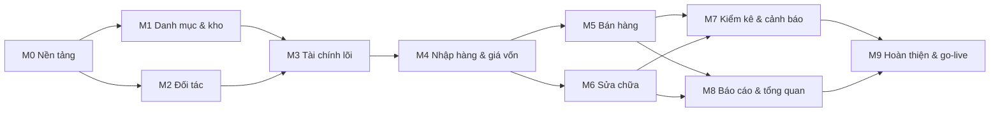

# Kế hoạch xây dựng (M0 → M9)

> Cập nhật lần cuối: 2026-10-16 · Trạng thái: Duyệt
> Thứ tự theo **phụ thuộc**, không theo thời lượng (xây bằng AI nên không ước tính tháng). Mỗi mốc có **tiêu chí vào**, **phạm vi**, **kiểm thử bắt buộc**, **Định nghĩa hoàn thành (DoD)**. Chỉ sang mốc sau khi DoD mốc trước xong và `fn_consistency_check()` sạch. Mapping FR→mốc: `requirements`.

## 0. Tổng quan phụ thuộc


(M5 và M6 độc lập sau M4 — có thể làm song song nếu dùng nhiều tác tử, xem §3.)

## 1. Các mốc

### M0 — Nền tảng
**Mục tiêu:** khung chạy được, an toàn, có đăng nhập–phân quyền–audit–CI–sao lưu.
**Phạm vi:**
- Scaffold Next (App Router, TS strict, Tailwind), ESLint/Prettier, `pnpm`, `.gitignore/.vercelignore/.env.example`, `vercel.json` (`sin1`, cron), CI.
- **Port từ Lưu Xá** (đổi `luuxa_`→`wf_`, cookie `__Host-wf_*`, bỏ phần đặc thù: phụng vụ, Zalo, video, geo, cộng đoàn):
  `src/server/{db,http,errors,ops,pii,storage,outbox,jobs,activity}.ts`, `src/server/auth/*`, `scripts/db/{pg,migrate,bundle,build,sql,audit,backup}.mjs`, `scripts/env/{gen-keys,dev-staging,bootstrap-admin→bootstrap-owner}.mjs`, `scripts/{setup-local,test-api,bump-version,check-version}.mjs`, `scripts/test-api/` (harness + auth + security-gates), `ops/backup-repo/*`, `.github/workflows/ci.yml`, các thành phần UI nền (`FormControls`→`src/components/ui/*`).
- Migration 0001–0003 (`migrations` §2): vai trò, hàm tiện ích, IAM, platform; seed quyền/vai trò/cài đặt.
- API & UI: đăng nhập/đăng xuất/đổi mật khẩu/TOTP/phiên; người dùng, vai trò & quyền, cài đặt, nhật ký, tệp (tải ảnh + thumbnail + EXIF), thông báo (khung), `/api/health`, hạ tầng `domain_events` + `dispatchEvents`.
- Khung giao diện: layout, **registry điều hướng theo quyền**, trang chủ rỗng theo vai trò, PWA (manifest, icon, service worker shell cache), `OfflineBanner`, sáng/tối, `lib/money.ts`, `lib/dates.ts`, `lib/permissions.ts`, `lib/settings-catalog.ts`.
- Phiên bản/changelog; `scripts/docs/check-docs.mjs` (bản đầu).
**Kiểm thử:** PT-07 (auth), PT-08/09 (bất biến audit), PT-10 (owner cuối), `db:audit`, `vitest` cho `money`/`dates` (allocate, làm tròn), mass-assignment.
**DoD:** đăng nhập được 5 vai trò demo; MFA owner; migrate ×2 sạch; `db:audit` xanh; CI xanh; deploy lên staging; `/api/health?deep=1` OK; **workflow sao lưu chạy thành công 1 lần** và diễn tập khôi phục vào DB tạm; `dev-setup` ghi lệnh thật.

### M1 — Danh mục & kho đồng hồ, linh kiện (master)
**Phạm vi:** migration 0004 (brands, watch_models, storage_locations, watch_units, unit_*, part_*); màn hình loại/thương hiệu, danh sách–chi tiết chiếc (ảnh, thông số, phụ kiện, vị trí, lịch sử giá/trạng thái), `fn_set_unit_price`, `fn_move_unit`, `fn_release_unit`, `fn_writeoff_unit`/`restore`, tìm kiếm (trigram, không dấu, quét QR), tem QR PDF, view `v_units_collab`, `v_stock_units`; linh kiện (danh mục, tương thích, ngưỡng) và `fn_adjust_part_stock`.
**Lưu ý:** chiếc **chỉ** được tạo bởi `fn_confirm_purchase` (M4, ADR-020). Trong M1–M3, chiếc được nạp bằng `db/seed` (script chạy bằng quyền chủ DB, **chỉ local/staging**, từ chối production). Sau M4, seed demo chuyển sang tạo qua phiếu nhập thật.
**Kiểm thử:** ma trận chuyển trạng thái (hợp lệ/không hợp lệ), bất biến `status` không UPDATE trực tiếp, PT-02 (CTV chỉ thấy view hẹp), upload ảnh (magic bytes, EXIF), tìm kiếm không dấu/gõ sai nhẹ.
**DoD:** FR-UNIT-04…13 (trừ phần tạo chiếc), FR-PART-01…03, FR-STK-01/02/03 (đọc), UAT-01 đạt trên seed.

### M2 — Đối tác
**Phạm vi:** migration 0005; khách hàng (CRUD, nhóm, tìm SĐT/tên, tạo nhanh, **PII mã hóa + xem có lý do + audit**, `customer_watches`), nhà cung cấp, `fn_anonymize_customer`; RLS cho `customer.view_own`.
**Kiểm thử:** PT-03 (phần khách của CTV), PT-12 (PII), trùng SĐT cảnh báo, tìm kiếm.
**DoD:** FR-CUS-01/06/07, FR-SUP-01, FR-BAK-05; UAT-03 (phần khách).

### M3 — Tài chính lõi
**Phạm vi:** migration 0006; quỹ + số dư đầu kỳ, `payments` + `payment_allocations`, sổ quỹ chuỗi băm (`fn_post_ledger_entry`, `fn_verify_ledger_chain`), phiếu thu/chi tổng quát (chi phí, vay, thu hộ, thu khác), chuyển quỹ, điều chỉnh quỹ, hủy phiếu (đảo), kỳ + đối chiếu + khóa/mở kỳ, "Chốt ngày", view `v_doc_balances` (khung), `app.round_vnd/allocate_vnd` ↔ `lib/money.ts`.
**Kiểm thử:** SC-13, SC-16; CT-05, CT-06, CT-10, CT-11; PT-09; hash chain đúng khi 50 bút toán song song; không âm quỹ; kỳ khóa chặn.
**DoD:** FR-FIN-05/08/09/10, FR-COST-07/08 (phần quỹ), UAT-07 (thu chi). Ghi nhận: đến đây **chưa có doanh thu**, nên chưa có báo cáo lãi.

### M4 — Nhập hàng & giá vốn
**Phạm vi:** migration 0007; phiếu nhập (nháp/xác nhận/hủy) các loại `supplier`, `customer_buyback`, `opening`; dòng đồng hồ/linh kiện; **chi phí liên quan + phân bổ**; **sinh chiếc + mã nội bộ**; `unit_cost_entries`; kho linh kiện + giá bình quân; thanh toán/công nợ NCC; `fn_adjust_unit_cost`; thu mua từ khách (giấy tờ người bán, biên bản); PDF phiếu nhập + Excel; "Nhập nhanh một chiếc"; in tem sau xác nhận; quyền `cost.view`/`debt.view_supplier` thực thi ở RLS/view.
**Kiểm thử:** SC-01, SC-11, SC-17; CT-09, CT-12; PT-01 (phần giá vốn/phiếu nhập), `fn_consistency_check` I8–I10; nhập lại chiếc cũ (chu kỳ +1).
**DoD:** FR-PUR-01…13, FR-COST-01/02/09, FR-SUP-02…05, FR-PART-04/06, FR-UNIT-06; UAT-02; seed demo chuyển sang qua phiếu nhập.

### M5 — Bán hàng
**Phạm vi:** migration 0008; giữ hàng/cọc; phiếu bán nháp→xác nhận (POS mobile-first, quét QR, giảm giá theo hạn mức, thanh toán kết hợp, tiền thừa, nợ + hạn, in phiếu); **thu cũ đổi mới**; hủy phiếu (cửa sổ); **đổi trả**; bán linh kiện lẻ; **bảo hành** (bán); **CTV** (đơn nháp, hoa hồng, chi trả, clawback); thu nợ; nhắc nợ; `sale_line_costs`; công nợ khách.
**Kiểm thử:** SC-02…07, SC-12, SC-15; CT-01, CT-02, CT-03, CT-07, CT-08; PT-02, PT-03, PT-11; `fn_consistency_check` I1–I7, I12.
**DoD:** FR-SALE-01…16, FR-RSV-*, FR-TRD-*, FR-COL-*, FR-STK-04/05, FR-FIN-01/03/06, FR-CUS-02/04/05/08, FR-COST-04/05; UAT-03; e2e POS 390px.

### M6 — Sửa chữa & linh kiện sử dụng
**Phạm vi:** migration 0009; nhận máy (ảnh bắt buộc, bất biến), kiểm tra, báo giá + khách đồng ý, phân công, dòng nhân công/linh kiện, xác nhận dùng (trừ kho), trạng thái đầy đủ, hoàn thành/giao/hủy, cọc sửa, **sửa nội bộ vốn hóa**, tiền công thợ theo từng thợ, bảo hành sau sửa (phiếu `warranty_free`), lịch sử theo serial, PDF phiếu nhận/giao, "Việc của tôi" cho thợ.
**Kiểm thử:** SC-08, SC-09; CT-04; PT-04 (thợ chỉ thấy việc được giao, không giá vốn, thấy tiền công của mình).
**DoD:** FR-REP-01…16, FR-COST-03, FR-PART-07/08, FR-FIN-02, FR-CUS-03; UAT-06.

### M7 — Kiểm kê, cảnh báo & thông báo
**Phạm vi:** migration 0010; kiểm kê (quét QR đếm, đối chiếu, lý do, chốt), hao hụt, `v_unit_aging`, `v_part_low_stock`, cron daily (giữ hàng quá hạn, nợ đến hạn, bảo hành sắp hết, máy chưa lấy, linh kiện thấp, tồn lâu), thông báo trong ứng dụng (chuông), `fn_consistency_check` đầy đủ + cron evening, cảnh báo sao lưu.
**Kiểm thử:** SC-14; CT-13; chạy cron giả thời gian; I1–I13.
**DoD:** FR-STK-06…10, FR-PART-09, FR-DASH-08, FR-REP-17, FR-RSV-04, FR-PLAT-02, FR-PLAT-04; UAT-04.

### M8 — Báo cáo & tổng quan
**Phạm vi:** migration 0011 (`rpt_*`); dashboard theo vai trò; 12 báo cáo (R1–R12) với lọc ngày, Excel/PDF, quyền; trang chủ từng vai trò.
**Kiểm thử:** SC-10 (chốt ngày tổng hợp, hằng đẳng thức doanh thu–thực thu–công nợ), đối chiếu số liệu từng báo cáo với SC-01…09; PT-01/PT-05 (xuất file theo quyền); hiệu năng truy vấn.
**DoD:** FR-DASH-*, FR-RPT-*, FR-COST-06, FR-FIN-07, FR-SUP-06, FR-STK-09; UAT-05, UAT-07.

### M9 — Hoàn thiện & go-live
**Phạm vi:** chạy **đầy đủ** CT/PT/SC; kiểm định độc lập (`/code-review`, `/security-review`, rà RLS, thử tấn công mass-assignment/đồng thời); sửa lỗi; hiệu năng & tải nhẹ; a11y; PWA & camera trên điện thoại thật; **sao lưu + diễn tập khôi phục có biên bản**; hướng dẫn sử dụng theo vai trò (`src/content/guide.ts` → `docs/07-user-guide`); sinh từ điển dữ liệu & ma trận quyền; `docs:check`; thiết lập production (Supabase Pro, Vercel Pro, tên miền, khóa riêng, MFA owner); nhập tồn đầu kỳ + số dư đầu kỳ; đào tạo; UAT chính thức (`uat-acceptance`); bàn giao (`runbook` §Bàn giao).
**DoD:** toàn bộ UAT-01…10 đạt; checklist go-live xong; báo cáo test phát hành lưu; chủ cửa hàng ký nghiệm thu.

## 2. Quy trình làm việc trong **một mốc** (với Claude Code)

1. **Chuẩn bị:** mở phiên, `CLAUDE.md` tự nạp. Dán mục mốc ở §1 + liệt kê docs liên quan (`business-rules` đoạn BR của mốc, `data-model` đoạn bảng, `integrity-and-concurrency`, `security-model`). Yêu cầu *lập kế hoạch trước* (plan mode) rồi duyệt.
2. **Thứ tự bắt buộc:** (a) cập nhật docs nếu phát hiện thiếu/mâu thuẫn → (b) migration + test cấu trúc → (c) test DB/tích hợp (SC/CT/PT) viết trước hoặc cùng lúc → (d) module máy chủ + route → (e) hook + giao diện → (f) e2e/ảnh chụp 390px → (g) docs/guide/changelog.
3. **PR nhỏ** theo lát cắt dọc (một `fn_*` + API + màn hình + test), mỗi PR đạt DoD của `CLAUDE.md`.
4. **Đừng để AI đoán nghiệp vụ:** thiếu quy tắc ⇒ AI hỏi/ghi vào mục "Câu hỏi mở" của mốc, không tự bịa. Số tiền luôn lấy từ `golden-scenarios`.
5. **Sau mỗi lát cắt động tới tiền/kho/quyền:** chạy `pnpm test:api` (SC+CT+PT liên quan) và `fn_consistency_check()`.
6. **Cuối mốc:** chạy toàn bộ test; `/code-review` và (nếu đụng bảo mật) `/security-review`; đánh `☑` các FR trong `requirements`; cập nhật `docs/README` trạng thái; tăng phiên bản; deploy staging; kiểm tay theo UAT của mốc.

### Mẫu mô tả giao việc cho AI (copy & điền)

```
Mốc: M<n> — <tên>. Làm lát cắt: <fn/ màn hình>.
Đọc trước: CLAUDE.md; docs/04-engineering/build-plan.md §M<n>; BR: <ID…>; data-model: <bảng…>; golden-scenarios: <SC…>.
Yêu cầu: (1) lập kế hoạch ngắn rồi dừng chờ duyệt; (2) migration theo migrations.md (checklist bảng/hàm); (3) test SC/CT/PT trước; (4) module + route + UI mobile-first;
         (5) không sửa file migration cũ; (6) cập nhật docs/guide/changelog; (7) báo kết quả test + file đã đổi.
Ràng buộc: tiền là bigint VND; ghi nghiệp vụ qua fn_*; không secret trong code; mâu thuẫn docs ⇒ dừng hỏi.
```

## 3. Chạy song song nhiều tác tử (tùy chọn, sau M0)

Chỉ khi các lát cắt **không chung file**. Theo mẫu `docs/packages/*` + `BRIEF_COMMON.md` của Lưu Xá:
- Mỗi gói có **danh sách file sở hữu**; file dùng chung (`lib/permissions.ts`, `settings-catalog.ts`, nav registry) chỉ được *thêm nhỏ* và đọc lại ngay trước khi sửa.
- Số migration **được giao trước** cho từng gói (tránh trùng số); không sửa migration đã có.
- Cấm: commit/push/stash/reset trong phiên con; chạy `build` (chỉ người điều phối); lệnh nặng bọc khóa dùng chung nếu máy ít RAM.
- Báo cáo cuối của gói: đã làm · test (x/y) · chưa làm · cần gói khác · đề xuất cập nhật docs/guide.
Gợi ý chia: **M5** (bán/giữ hàng/đổi trả/CTV) ∥ **M6** (sửa chữa) sau M4.

## 4. Cổng kiểm soát trước khi sang mốc kế

| Cổng | Điều kiện |
|---|---|
| G1 Docs | BR/SC của mốc đã đủ, FR đánh dấu, không mâu thuẫn |
| G2 DB | `db:audit` xanh; migrate ×2 sạch; RLS+FORCE mọi bảng mới |
| G3 Test | SC/CT/PT của mốc xanh; `vitest` xanh; `fn_consistency_check()` sạch |
| G4 Bảo mật | Không endpoint mới lộ trường nhạy cảm (PT); không bí mật trong repo |
| G5 UX | Kiểm tay trên điện thoại thật (hoặc 390px) cho luồng chính; a11y cơ bản |
| G6 Triển khai | Đã chạy trên staging; changelog; phiên bản tăng |

## 5. Rủi ro theo mốc & cách giảm

| Rủi ro | Mốc | Giảm |
|---|---|---|
| Auth port thiếu test ⇒ lỗ hổng | M0 | Port kèm bộ test; PT-07; xoay khóa; review `/security-review` |
| Quyền Supabase (BYPASSRLS, tạo role) khác kỳ vọng | M0 | Kiểm sớm trên staging ở M0; phương án `SET ROLE` thay vì `BYPASSRLS` (`migrations` §3) |
| Sổ quỹ tắc nghẽn khóa quỹ | M3 | Một quỹ = một hàng đợi khóa; giao dịch ngắn; đo p95 ghi |
| Làm tròn sai lệch 1 đồng | M4, M5 | `allocate` có test thuộc tính (ngẫu nhiên); đối chiếu TS↔SQL |
| POS chậm trên điện thoại | M5 | Danh sách ảo hóa, tìm kiếm server, bundle nhỏ, e2e đo |
| Phạm vi sửa chữa làm vỡ kho linh kiện | M6 | CT-04 trước khi làm UI; khóa dòng linh kiện |
| Báo cáo lệch định nghĩa | M8 | Mọi báo cáo dùng `rpt_*` đã có SC đối chiếu; dashboard = cùng hàm |
| Quên diễn tập khôi phục | M0, M9 | Cổng DoD M0 và M9 bắt buộc biên bản |
